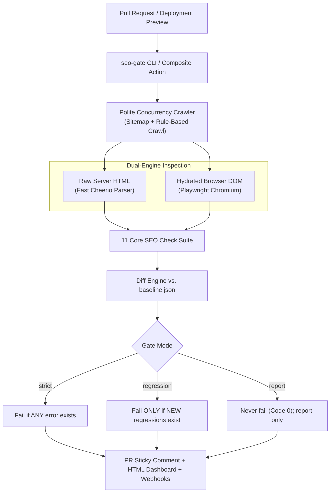

# 🛡️ seo-gate

<p align="center">
  
  <h1 align="center">seo-gate</h1>
  <p align="center">
    <strong>The Automated SEO Regression Guard for CI/CD Pipelines</strong><br />
    <em>Prevent accidental <code>noindex</code> tags, dropped canonicals, broken metadata, and search visibility drops before code ever reaches production.</em>
  </p>
</p>

<p align="center">
  <a href="https://www.npmjs.com/package/seo-gate"></a>
  <a href="https://github.com/majhiiii/seo-gate/actions"></a>
  <a href="https://www.typescriptlang.org/"></a>
  <a href="https://github.com/majhiiii/seo-gate/blob/main/LICENSE"></a>
  <a href="https://github.com/majhiiii/seo-gate/stargazers"></a>
</p>

---

## ⚡ The Nightmare seo-gate Solves

You deploy a routine PR on Friday afternoon. Everything passes unit tests and Cypress flows. But silently:
1. **The Accidental `noindex`:** An environment variable toggle leaks `<meta name="robots" content="noindex">` from staging into production. Google de-indexes your primary product catalog over the weekend.
2. **The Dropped Canonical:** A React / Next.js / Astro router refactor converts `<link rel="canonical">` into a relative path or strips it entirely, creating thousands of duplicate content penalties.
3. **The Hydration Void:** Client-side JavaScript renders your `<h1>` and structured data. But search crawlers parsing raw server HTML receive an empty `<div>`, destroying your ranking signals.

**`seo-gate` turns SEO technical specifications into deterministic regression tests in your CI/CD pipeline.**

```text
$ npx seo-gate run -c seo-gate.config.yml -b baseline.json --mode regression

🔍 seo-gate v0.1.0: Auditing https://preview-pr-142.store.com against baseline.json
   ✓ Crawled 42 pages across sitemap & include rules (concurrency: 4)
   ✓ Dual-engine inspection: Cheerio HTML + Playwright Headless Chromium DOM
   ✓ Comparing findings against baseline snapshot...

═══════════════════════════════════════════════════════════════════════════
                           REGRESSION DETECTED                             
═══════════════════════════════════════════════════════════════════════════
 Target:      https://preview-pr-142.store.com
 Baseline:    baseline.json (production snapshot)
 Audited:     42 page(s)
 Regressions: 1 new error (0 resolved, 2 existing baseline warnings ignored)
 Duration:    2.41s
═══════════════════════════════════════════════════════════════════════════

✗ [REGRESSION] noindex on /products/wireless-headphones
  Page contains <meta name="robots" content="noindex"> but is configured to be indexable.
  Fix Hint: Remove "noindex" from the robots meta tag before deploying to production.

❌ Gate Failed: SEO regression detected. Exiting with code 1.
```

---

## ⚔️ Why Not Existing Tools?

| Feature | `seo-gate` | Lighthouse CI | Screaming Frog | Cypress / Playwright |
|:---|:---:|:---:|:---:|:---:|
| **Automated Pull-Request Gate** | **✅ Built-in** | ⚠️ Performance only | ❌ Desktop GUI only | ⚠️ Custom code required |
| **Baseline Regression Diffing** | **✅ Only fails on new errors** | ❌ Hard thresholds only | ❌ | ❌ Custom implementation |
| **Raw vs. Rendered DOM Diff** | **✅ Catches hydration gaps** | ❌ | ⚠️ Heavy headless crawl | ❌ |
| **Sticky PR Comment Updates** | **✅ 1 Idempotent Comment** | ⚠️ No regression diff | ❌ | ❌ |
| **Hreflang Reciprocity Audit** | **✅ Bidirectional verification** | ❌ | ✅ Manual run | ❌ |
| **Flaky Protection (Lab Audits)** | **✅ Median-of-3 + 2-strike** | ⚠️ Single run jitter | ❌ | ❌ |
| **Price & Licensing** | **✅ 100% Free & Open Source (MIT)** | ✅ Free | ❌ $259 / license / year | ✅ Free |

---

## 🚀 Key Architectural Superpowers

- 🎯 **Regression-First Gate Engine:** Diffs your preview deployment against a production baseline. Existing technical debt won't block feature pull requests—builds fail **only** when a new error is introduced.
- ⚡ **Dual-Engine Crawling (Raw vs. Rendered):** Compares fast server-rendered HTML (via Cheerio) against hydrated client-side DOM (via Playwright headless Chromium) to catch content that only exists after JavaScript runs.
- 📌 **Idempotent Sticky PR Comments:** Automatically posts or updates a single markdown table comment on GitHub pull requests. Zero spam across repeated commits.
- ⏱️ **Lab Budgets with Flaky Protection:** Programmatic Lighthouse integration running median-of-3 measurements with a 2-strike verification rule so runner CPU fluctuations never break your build.
- 🛡️ **Zero Secret Leakage:** Automatically redacts basic-auth credentials (`user:pass`) and sensitive query parameters (`token`, `auth`, `key`) from URLs in all console logs, reports, and webhooks.
- 📊 **Multi-Format Reporting:** Generates versioned JSON (`schemaVersion: 1`), PR Markdown diffs, Slack / Microsoft Teams alert cards, and a zero-dependency interactive HTML report.

---

## 🔄 How It Works



---

## 🚦 Three Gate Modes

| Mode | Exit Behavior | Best Used For |
|---|---|---|
| **`regression`** *(Default)* | Fails (`exit 1`) **only** if brand-new errors exist compared to the baseline snapshot. Existing legacy errors are tracked but do not fail the gate. | Active engineering teams shipping features on existing sites. |
| **`strict`** | Fails (`exit 1`) if **any** error exists across the audited page set, regardless of baseline. | Greenfield projects, release branches, or zero-debt sites. |
| **`report`** | Always succeeds (`exit 0`). Outputs findings, writes HTML reports, and updates PR comments. | Initial 2-week team rollout to establish baselines without blocking merges. |

---

## ⚡ 60-Second Quick Start

### 1. Scaffold Configuration

```bash
# Initialize with your preview or local URL
npx seo-gate init https://preview.example.com
```

This creates a starter `seo-gate.config.yml` with production-safe defaults:

```yaml
target: https://preview.example.com
mode: regression

pages:
  include:
    - "/"
    - "/products/*"
    - "/categories/*"
  exclude:
    - "/checkout/*"
    - "/account/*"
  sitemap: true
  crawl:
    concurrency: 4
    delayMs: 100

checks:
  title: { min: 20, max: 65, unique: true }
  metaDescription: { min: 70, max: 160, unique: true }
  h1: { requireExactOne: true }
  canonical: { requireSelfReferencing: true }
  noindex: { allowOnStaging: false }

budgets:
  lcpMs: 2500
  cls: 0.1
  totalJsKb: 500
  tolerancePercent: 10

ignore:
  - check: "title-length-short"
    url: "/legal/*"
    reason: "Statutory title required by corporate legal compliance"
```

### 2. Capture Production Baseline

```bash
npx seo-gate baseline update -c seo-gate.config.yml -o baseline.json
```

Commit `baseline.json` to your repository so CI can compare against it.

### 3. Run the Regression Gate

```bash
npx seo-gate run -c seo-gate.config.yml -b baseline.json
```

---

## 🤖 GitHub Actions Integration

Add `seo-gate` to `.github/workflows/seo-gate.yml` to automatically verify every pull request:

```yaml
name: SEO Quality Gate

on:
  pull_request:
    branches: [main]

permissions:
  contents: read
  pull-requests: write

jobs:
  seo-gate:
    runs-on: ubuntu-latest
    steps:
      - uses: actions/checkout@v4

      - name: Run seo-gate
        uses: majhiiii/seo-gate@v0.1.0
        with:
          target-url: ${{ env.PREVIEW_URL }}
          config-path: seo-gate.config.yml
          baseline-path: baseline.json
          mode: regression
          github-token: ${{ secrets.GITHUB_TOKEN }}
          slack-webhook: ${{ secrets.SLACK_WEBHOOK_URL }}
```

### 💬 Sticky PR Comment Preview

Whenever a developer opens or updates a pull request, `seo-gate` posts a clean, single sticky comment:

> ### 🛡️ seo-gate: Regression Detected
>
> **Target:** `https://preview-pr-142.store.com`  
> **Mode:** `regression` | **Audited:** 42 pages  
> **Status:** ❌ 1 new regression (0 resolved, 2 baseline warnings)
>
> | Severity | Check | URL | Message | Fix Hint |
> |:---:|---|---|---|---|
> | ❌ | `noindex` | `/products/wireless-headphones` | Page contains `noindex` in meta tag | Remove `noindex` directive before merge |
>
> <details>
> <summary><b>View Unchanged Baseline Warnings (2)</b></summary>
>
> - `title-length-short` on `/about` (14 chars)
> - `meta-description-missing` on `/contact`
> </details>

---

## 🔍 The 11 Core Checks

| Check ID | Severity | What It Inspects & Catches |
|---|:---:|---|
| **`noindex`** | `error` | Catches accidental `noindex` meta tags or `X-Robots-Tag` headers on indexable pages. |
| **`http-status`** | `error` | Asserts HTTP 200; flags 4xx/5xx errors, redirect chains (>1 hop), and redirect loops. |
| **`canonical`** | `error` | Asserts existence, absolute URL format, self-referencing consistency, and non-404 targets. |
| **`robots-txt`** | `error` | Asserts `robots.txt` exists, flags accidental `Disallow: /`, and verifies critical paths. |
| **`rendered-vs-raw`** | `error` | Compares raw Cheerio HTML vs Playwright DOM to catch the **client-side hydration gap**. |
| **`title`** | `warn` / `error` | Asserts presence, uniqueness across page set, and length bounds (default: 20–65 chars). |
| **`meta-description`** | `warn` | Asserts presence, uniqueness, and length bounds (default: 70–160 chars). |
| **`h1`** | `warn` / `error` | Asserts exactly one `<h1>` heading per page. |
| **`structured-data`** | `warn` / `error` | Validates JSON-LD syntax and asserts required schema properties (`Product`, `BreadcrumbList`, etc.). |
| **`hreflang`** | `error` | Asserts ISO language codes, self-references, and reciprocal return tags across languages. |
| **`sitemap`** | `warn` / `error` | Asserts sitemap URLs return 200, are canonical, and flags sudden URL drops (>10%). |

---

## 📊 Standalone Interactive HTML Report

Generate a portable, single-file HTML audit dashboard that non-developers (SEO specialists, product managers) can open directly in their browser:

```bash
npx seo-gate run -c seo-gate.config.yml --html report.html
```

- 🔍 **Live Filtering:** Instant filter by severity (`error`, `warn`, `info`), check ID, or URL search.
- 🔬 **Tag Evidence Inspector:** Shows the exact HTML snippet or response header that triggered the finding.
- 💡 **Actionable Fix Hints:** Plain-English remediations for developers and content editors.
- 🗂️ **Zero Dependencies:** Fully self-contained single HTML file with embedded styling.

---

## 🛠️ CLI Command Reference

```bash
seo-gate [command] [options]

Commands:
  init [target]                        Generate a starter seo-gate.config.yml configuration
  run                                  Execute crawler, checks, and regression gate
  baseline update                      Crawl target or production and write a fresh baseline snapshot
  diff <baseline.json> <report.json>   Compare two run results and display regression summary

Options for `run`:
  -c, --config <path>                  Path to YAML configuration file [required]
  -b, --baseline <path>                Path to baseline JSON snapshot (for regression mode)
  -m, --mode <mode>                    Override gate mode: 'strict', 'regression', 'report'
  -f, --format <format>                Report formats: 'json', 'md', 'html' (default: 'json')
  -o, --output <path>                  Custom report output file path
  --html <path>                        Generate standalone interactive HTML report file
  --performance                        Run programmatic Lighthouse lab audits on critical pages
  --pr <number>                        Pull request number for posting sticky GitHub comment
  --github-token <token>               GitHub token with pull-requests:write permission
  --slack-webhook <url>                Slack incoming webhook URL for alert cards
  --teams-webhook <url>                Microsoft Teams webhook URL
  -v, --version                        Output current version
  -h, --help                           Display CLI help
```

---

## 📦 Programmatic TypeScript / Node.js SDK

You can also embed `seo-gate` directly into your internal tooling, build scripts, or custom deployment pipelines:

```typescript
import {
  loadConfig,
  crawlTarget,
  runChecks,
  evaluateGate,
  generateHtmlReport,
  generateMarkdownReport
} from 'seo-gate';

// 1. Load validated configuration
const config = loadConfig('seo-gate.config.yml');

// 2. Crawl preview environment
const pages = await crawlTarget(config);

// 3. Execute pure SEO inspection rules
const runResult = runChecks(pages, config);

// 4. Evaluate against baseline snapshot
const gateResult = evaluateGate(runResult.findings, {
  mode: config.mode,
  baselineFindings: previousBaseline.findings
});

if (!gateResult.passed) {
  console.error(`Gate failed with ${gateResult.regressions.length} regressions!`);
}

// 5. Generate interactive HTML dashboard
const html = generateHtmlReport({
  target: config.target,
  mode: config.mode,
  totalPages: pages.length,
  passed: gateResult.passed,
  findings: runResult.findings,
  regressions: gateResult.regressions
});
```

---

## 🧪 Quality & Test Standards

`seo-gate` is built with 100% strict TypeScript and validated with an exhaustive Vitest suite:

```bash
# Run 125+ automated unit, integration, and CLI tests
pnpm test

# Run tests with code coverage report (>= 85% checks gate)
pnpm test:coverage

# Compile TypeScript production build
pnpm build
```

---

## 🤝 Contributing

Contributions, feature ideas, and pull requests are warmly welcomed! Please read [CONTRIBUTING.md](CONTRIBUTING.md) for local development setup guidelines and code principles.

If you find `seo-gate` helpful, please consider **giving it a star ⭐ on GitHub**—it helps more engineering teams protect their search visibility!

---

## 📄 License

Distributed under the [MIT License](LICENSE).
