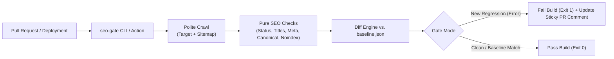

# 🛡️ seo-gate

> **The Automated SEO Regression Guard for CI/CD Pipelines.**  
> Prevent accidental `noindex` tags, dropped canonicals, broken titles, and search visibility loss before code reaches production.

---

## ⚡ The Problem

Developers move fast. In rapid deployment cycles, template adjustments, router tweaks, or environment switches frequently introduce silent SEO regressions:
- A staging configuration leaves `<meta name="robots" content="noindex">` on production.
- A component refactor drops `<link rel="canonical">` or makes it relative.
- A routing change creates multi-hop redirect chains or loops.
- Title and description tags get duplicated or stripped.

Because visual layouts and functional checkout flows still pass tests, these regressions silently deploy to production—wiping out organic search traffic, customer discovery, and store revenue before anyone notices.

**seo-gate turns SEO specifications into automated regression tests for your CI/CD pipeline.**

---

## 🚀 Key Features

- **🎯 Regression-First Gate:** Diffs preview environments against your production baseline. Fails builds *only* when new errors are introduced—pre-existing debt won't block feature pull requests.
- **⚡ Polite Asynchronous Crawler:** Bounded concurrency pool (default: 4 workers) with polite pacing delays to prevent overwhelming preview or staging servers.
- **📌 Idempotent Sticky PR Comments:** Automatically updates a single comment on GitHub pull requests. Zero bot spam across multiple commits.
- **🛡️ Zero Secret Leakage:** Automatically redacts basic-auth credentials and sensitive tokens from URLs in logs and reports.
- **📊 Multi-Format Reporting:** Generates versioned JSON (`schemaVersion: 1`), PR Markdown comments, and Slack/Teams alert cards.
- **💼 Enterprise Ready:** Tested on headless e-commerce storefronts, Salesforce Experience Cloud / B2B Commerce, and modern web frameworks (React, Next.js, Nuxt, Astro).

---

## 🔄 How It Works



---

## 🚦 Three Gate Modes

| Mode | Behavior | Best Used For |
|---|---|---|
| **`regression`** (Default) | Fails **only** if new errors exist that were not present in the baseline. | Active development teams with existing technical debt. |
| **`strict`** | Fails if **any** error exists across the audited page set. | Green-field projects and high-security release branches. |
| **`report`** | Never fails (always exits with code `0`); logs findings and comments. | Initial 2-week team onboarding and observational audits. |

---

## 💻 Quick Start

### 1. Installation

```bash
# Clone and install dependencies
git clone https://github.com/majhiiii/seo-gate.git
cd seo-gate
pnpm install
```

### 2. Scaffold Starter Configuration

```bash
pnpm seo-gate init https://preview.example.com
```

This creates a starter `seo-gate.config.yml`:

```yaml
target: https://preview.example.com
mode: regression

pages:
  include:
    - "/"
    - "/products/*"
    - "/category/*"
  exclude:
    - "/cart"
    - "/account/*"
  sitemap: true
  crawl:
    concurrency: 4
    delayMs: 100

checks:
  title: { min: 20, max: 65, unique: true }
  metaDescription: { min: 70, max: 160, unique: true }
  h1: { requireExactOne: true }
  canonical: { requireSelfReferencing: true }
  noindex: { allowOnStaging: false }

ignore:
  - check: "title-length-short"
    url: "/legal/*"
    reason: "Fixed statutory title required by compliance"
```

### 3. Capture Production Baseline

```bash
pnpm seo-gate baseline update --config seo-gate.config.yml --output baseline.json
```

### 4. Run the Audit

```bash
pnpm seo-gate run --config seo-gate.config.yml --baseline baseline.json
```

---

## 🤖 GitHub Actions Integration

Use our reusable composite action in `.github/workflows/seo-gate.yml`:

```yaml
name: SEO Quality Gate

on:
  pull_request:
    branches: [main]

permissions:
  contents: read
  pull-requests: write

jobs:
  seo-gate:
    runs-on: ubuntu-latest
    steps:
      - uses: actions/checkout@v4

      - name: Run seo-gate
        uses: ./
        with:
          target-url: ${{ env.PREVIEW_URL }}
          config-path: seo-gate.config.yml
          baseline-path: baseline.json
          mode: regression
          github-token: ${{ secrets.GITHUB_TOKEN }}
          slack-webhook: ${{ secrets.SLACK_WEBHOOK_URL }}
```

---

## 📚 Comprehensive Documentation

The full architecture and learning curriculum lives in the `/docs` directory:

- 🧭 **[Start Here](docs/00-START-HERE.md):** Onboarding guide, 30-min/3-hr reading paths, and quick demo.
- 📐 **[System Architecture](docs/02-system-design/architecture.md):** Decoupled layers, invariants, and module guide.
- 📊 **[Data Model](docs/02-system-design/data-model.md):** Zod schemas, ER diagrams, and `schemaVersion: 1`.
- 🔀 **[Sequence Diagrams](docs/02-system-design/sequence-diagrams.md):** PR workflows, baseline generation, and state transitions.
- 📖 **[Salesforce Analogies Guide](docs/05-learning/salesforce-analogies.md):** Concepts explained using Apex, Validation Rules, and Governor Limits.
- 🛠️ **[Operations Runbook](docs/06-operations/runbook.md):** Local SOPs, troubleshooting, and exit code reference.
- 👥 **[Team Rollout Plan](docs/06-operations/how-to-roll-out-to-the-team.md):** 4-week step-by-step rollout framework.

---

## 🧪 Testing & Quality Standards

```bash
# Run unit and integration test suite
pnpm test

# Run tests with code coverage report (>= 85% checks gate)
pnpm test:coverage

# Validate documentation internal links and references
pnpm docs:check
```

---

## 📄 License

Distributed under the [MIT License](LICENSE).
