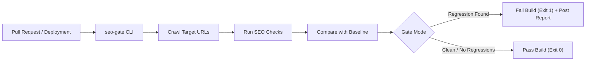

# 00: Start Here

## 1. In one paragraph
**seo-gate** is a command-line tool and CI/CD quality gate that automatically inspects web pages during pull requests and deployments, checking for missing titles, broken canonical links, accidental `noindex` directives, and SEO regressions before bad code reaches production.

## 2. Why this exists
In modern agile development—especially with headless storefronts, Salesforce Experience Cloud, and JavaScript applications—developers frequently make innocent code changes that silently wipe out search engine visibility. For example, a developer merging a staging configuration might accidentally leave `<meta name="robots" content="noindex">` on production, causing Google to de-index the entire catalog within days. `seo-gate` turns SEO best practices into automated tests that run on every pull request, preventing traffic-destroying accidents.

## 3. How it works
`seo-gate` crawls target URLs (from configuration lists or sitemaps), runs deterministic validation checks on each page's raw HTML and rendered output, compares the findings against a baseline snapshot, and fails the CI build if regressions are discovered.


*How to read this diagram: The workflow triggers on PR or deployment, executes the crawler and checks, diffs against the saved baseline, and determines the CI exit code based on the gate mode.*

### Reading Paths

#### 30-Minute Architecture & Concept Path
1. [00-START-HERE.md](file:///d:/seo-gate/docs/00-START-HERE.md) (this document)
2. [docs/02-system-design/overview.md](file:///d:/seo-gate/docs/02-system-design/overview.md)
3. [docs/02-system-design/architecture.md](file:///d:/seo-gate/docs/02-system-design/architecture.md)
4. [docs/05-learning/salesforce-analogies.md](file:///d:/seo-gate/docs/05-learning/salesforce-analogies.md)

#### 3-Hour Deep-Dive Engineering Path
1. Read all concepts:
   - [docs/01-concepts/seo-basics.md](file:///d:/seo-gate/docs/01-concepts/seo-basics.md)
   - [docs/01-concepts/http-basics.md](file:///d:/seo-gate/docs/01-concepts/http-basics.md)
   - [docs/01-concepts/how-crawlers-and-rendering-work.md](file:///d:/seo-gate/docs/01-concepts/how-crawlers-and-rendering-work.md)
2. Study system design:
   - [docs/02-system-design/data-model.md](file:///d:/seo-gate/docs/02-system-design/data-model.md)
   - [docs/02-system-design/architecture.md](file:///d:/seo-gate/docs/02-system-design/architecture.md)
3. Review learning aids:
   - [docs/05-learning/glossary.md](file:///d:/seo-gate/docs/05-learning/glossary.md)
   - [docs/05-learning/learning-checkpoints.md](file:///d:/seo-gate/docs/05-learning/learning-checkpoints.md)

### 5-Minute Quick Demo
1. Run local test fixture:
   ```bash
   pnpm test:fixture
   ```
2. Run `seo-gate` against the fixture site:
   ```bash
   pnpm seo-gate run --config fixtures/test-site/seo-gate.config.yml
   ```
3. Inspect output findings in terminal and the generated `seo-gate-report.json`.

## 4. Example
When running in `strict` or `regression` mode against a page with an accidental `noindex`:
```json
{
  "schemaVersion": 1,
  "summary": { "totalPages": 1, "errors": 1, "warnings": 0, "passed": false },
  "findings": [
    {
      "checkId": "noindex",
      "url": "https://preview.example.com/products/shoes",
      "severity": "error",
      "message": "Page contains a noindex directive but is configured to be indexable",
      "evidence": "<meta name=\"robots\" content=\"noindex, nofollow\">",
      "fixHint": "Remove 'noindex' from the meta robots tag or X-Robots-Tag HTTP header before production deployment.",
      "docsLink": "https://developers.google.com/search/docs/crawling-indexing/block-indexing"
    }
  ]
}
```

## 5. Salesforce analogy
Think of `seo-gate` as an automated **Apex Test Suite and Metadata Deployment Validation Rule** for your storefront. Just as you would never deploy changes to a production Salesforce org without running tests to verify that triggers and validation rules pass, you should never deploy web storefront changes without running `seo-gate` to ensure search engine visibility contracts are intact.

## 6. Common mistakes and What to remember
- **Mistake:** Assuming that if a page looks good to a human user in a browser, search engines can index it properly. (Search engine crawlers might not execute your JavaScript or may encounter a misconfigured `X-Robots-Tag` header).
- **Mistake:** Treating SEO checks as subjective opinions rather than deterministic regression gates.
- **Remember:** `seo-gate` is strictly deterministic; every check is a pure function that inspects concrete inputs (status, headers, HTML tags) and returns structured findings.
