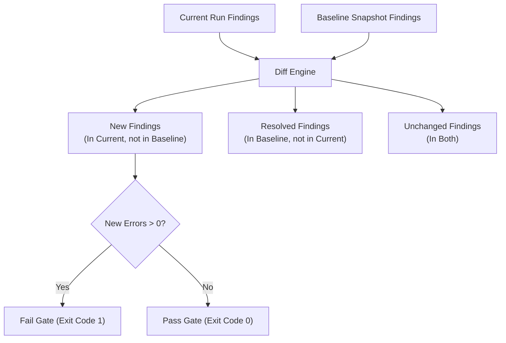

# Baselines and Regression Testing

## 1. In one paragraph
A baseline is a saved, versioned snapshot of known findings and metrics from a stable production or main branch run, allowing regression gates to fail pull requests only when new errors are introduced rather than failing on pre-existing technical debt.

## 2. Why this exists
Legacy websites and large enterprise storefronts rarely have zero SEO warnings; they may have dozens of slightly short meta descriptions or legacy redirect hops. If a CI tool is configured to fail whenever any warning or error exists (`strict` mode), developers working on unrelated features (like fixing a button color) get blocked by pre-existing issues they did not cause. A baseline snapshot records existing technical debt so the tool can mathematically calculate: `Regressions = Current Findings - Baseline Findings`.

## 3. How it works
1. **Baseline Snapshot Creation:** On the `main` branch or production deployment, `seo-gate baseline update` runs, generating a canonical `baseline.json` file.
2. **Path Normalization:** Because preview URLs differ by host (e.g., `https://preview-42.store.com/shoes` vs. `https://www.store.com/shoes`), finding identity keys are normalized by path: `${checkId}::${urlPath}`.
3. **Three-Way Finding Partitioning:**
   - **New Regressions:** Present in current run, absent from baseline.
   - **Resolved Issues:** Present in baseline, absent from current run (celebrated in reports!).
   - **Unchanged Debt:** Present in both runs.
4. **Gate Determination:**
   - In `regression` mode, only `new` errors cause exit code `1`.
   - Pre-existing baseline errors do not fail the build.


*How to read this diagram: Current findings and baseline findings are compared by the diff engine. Only newly introduced errors determine whether the gate fails.*

## 4. Example
Comparing a preview run with a baseline:
```json
{
  "summary": {
    "totalPages": 5,
    "currentErrors": 2,
    "baselineErrors": 1,
    "newRegressions": 1,
    "resolved": 0
  },
  "regressions": [
    {
      "checkId": "noindex-meta",
      "url": "https://preview-42.example.com/shoes",
      "severity": "error",
      "message": "Page contains a noindex directive but is configured to be indexable"
    }
  ]
}
```
Here, 1 error was already present in the baseline. The PR introduced 1 *new* error (`noindex-meta`). In `regression` mode, the build fails specifically because `newRegressions == 1`.

## 5. Salesforce analogy
In Salesforce development:
- A baseline is like taking a **Full Org Metadata Snapshot or Test Run Result** before beginning a sprint.
- If an existing org has 10 legacy Apex test failures in unmaintained code, requiring 100% passing tests halts all deployments.
- Using `RunSpecifiedTests` in Salesforce deploys changes if only the tests relevant to your change pass. Similarly, `regression` mode ignores pre-existing org debt and validates that your PR did not introduce *new* test failures or validation errors.

## 6. Common mistakes and What to remember
- **Mistake:** Comparing absolute URLs including hostnames directly without normalization. (A preview URL like `https://preview-88.vercel.app/shoes` would never match `https://www.myshop.com/shoes` in the baseline, resulting in 100% false regressions).
- **Mistake:** Forgetting to update the baseline after fixing issues or intentionally launching new pages.
- **Remember:** In `regression` mode, only *newly introduced errors* trigger exit code `1`.
