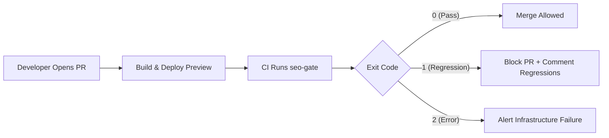

# CI/CD Concepts for Web and SEO Quality Gates

## 1. In one paragraph
Continuous Integration and Continuous Deployment (CI/CD) is an automated software engineering practice where code changes are automatically tested, built, validated, and deployed whenever developers push commits or open pull requests.

## 2. Why this exists
In traditional manual deployments, quality checks are infrequent, subjective, and prone to human error. A developer might manually test that the checkout button works, but miss that a router configuration change stripped canonical tags or introduced a `noindex` tag. CI/CD runs automated regression gates on every branch and pull request, catching defects within minutes of being written, before changes can ever reach staging or production.

## 3. How it works
In modern CI/CD pipelines (such as GitHub Actions):
1. **Trigger:** A developer opens a pull request (PR) or merges code into `main`.
2. **Preview Environment Deployment:** The CI system spins up an ephemeral preview deployment (e.g., Vercel, Netlify, or a staging scratch environment) hosting the new code.
3. **Automated Testing:** CI runs automated unit tests, linter checks, and specialized tools like `seo-gate`.
4. **Gate Evaluation:** The tool exits with a status code (`0` for success, `1` for policy violation). If the gate fails, CI halts the deployment.
5. **Feedback Loop:** Summary findings and links to detailed reports are posted directly back into the pull request comments.


*How to read this diagram: Code changes trigger preview deployments and automated gates. An exit code of 0 allows the pull request to merge, while exit code 1 blocks merging and reports regressions.*

## 4. Example
A typical GitHub Actions workflow step executing `seo-gate`:
```yaml
- name: Run seo-gate regression check
  run: |
    pnpm seo-gate run \
      --config seo-gate.config.yml \
      --baseline .seo-gate/baseline.json \
      --mode regression \
      --format md \
      --output pr-comment.md
```

## 5. Salesforce analogy
In Salesforce development:
- CI/CD is like an **Automated DevOps Pipeline using GitHub Actions and Salesforce CLI (`sf project deploy start`)**.
- A Pull Request preview is like deploying your feature branch into a dedicated **Scratch Org**.
- An SEO gate in CI is like running **Apex Unit Tests and Validation Rules (`--test-level RunLocalTests`)** before allowing a change set or metadata deployment to succeed.
- If an Apex test fails, the deployment status is set to `Failed`, and deployment to production is aborted.

## 6. Common mistakes and What to remember
- **Mistake:** Running CI tests against an environment that hasn't finished booting up, causing false test failures due to connection timeouts.
- **Mistake:** Setting quality gates to `strict` mode immediately across an existing codebase with hundreds of legacy warnings, which paralyzes developer velocity.
- **Remember:** Start teams in `mode: report` or `mode: regression` so they only fix new regressions caused by their specific PR.
