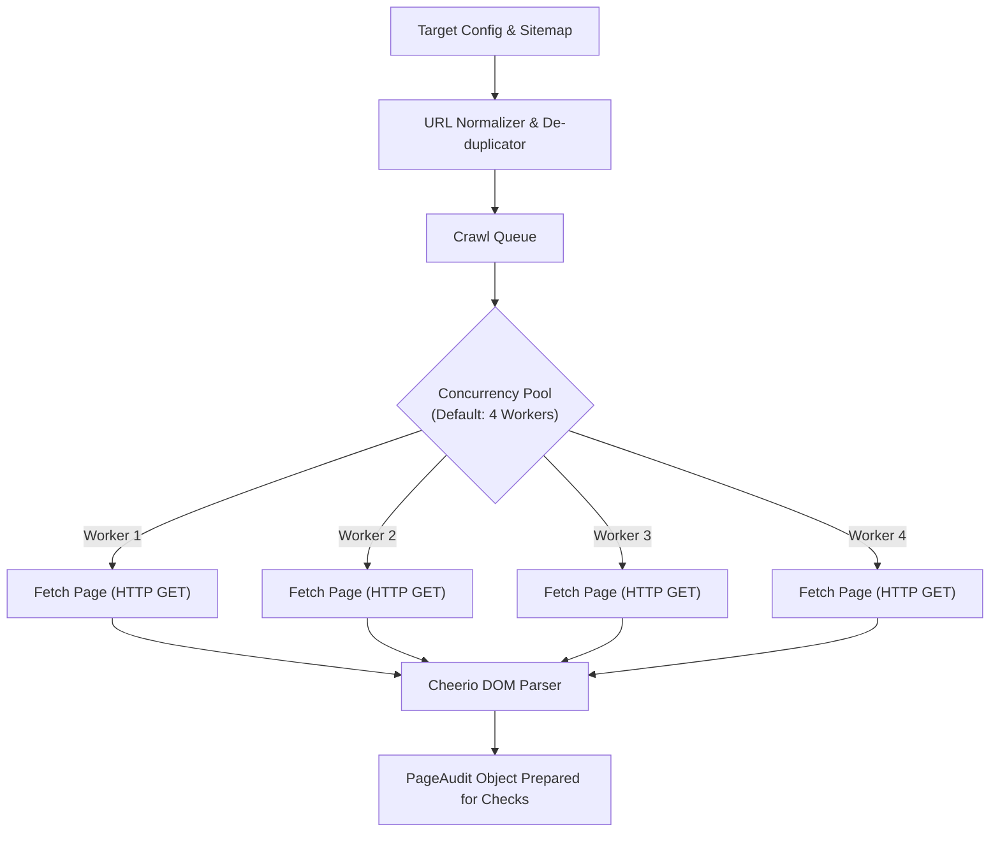

# How Crawlers and Rendering Work

## 1. In one paragraph
A web crawler is an automated program that systematically downloads web pages by following links and reading sitemaps, extracting data and metadata to evaluate how pages look to search engines.

## 2. Why this exists
Automated testing of an entire site or staging storefront requires fetching multiple URLs sequentially or concurrently without bringing down the server or getting blocked by rate limiters. Understanding how a crawler works—queueing URLs, managing concurrency, honoring polite delays, and distinguishing between raw server HTML responses and client-side JavaScript rendering—is essential for building reliable CI/CD quality gates.

## 3. How it works
The `seo-gate` crawler operates in a structured pipeline:
1. **Target Discovery:** Reads configured static URLs and downloads XML sitemaps specified in `seo-gate.config.yml`.
2. **Work Queue Initialization:** De-duplicates URLs, normalizes trailing slashes, and populates an internal asynchronous queue.
3. **Controlled Fetching:** Pulls URLs from the queue using a concurrency limiter (default: 4 concurrent requests) with a polite delay (default: 100ms) to prevent overwhelming the target host.
4. **Response Ingestion:** Captures the HTTP response status code, response headers (such as `X-Robots-Tag`), and raw HTML body.
5. **DOM Parsing:** Passes the raw HTML text to Cheerio (an in-memory, server-side DOM parser based on jQuery syntax) for fast, memory-efficient inspection without the overhead of spinning up a full browser.


*How to read this diagram: The URL queue feeds a pool of concurrent workers adhering to concurrency limits. Each worker executes an HTTP GET request and feeds raw HTML to the in-memory parser.*

### Raw vs. Rendered HTML
- **Raw HTML (Cheerio):** The raw string returned by the web server directly over HTTP before any JavaScript executes. It is blazingly fast to fetch and inspect (milliseconds per page).
- **Rendered HTML (Playwright):** The DOM tree after a headless browser downloads scripts, executes framework bundles (React, Vue, LWC), and evaluates dynamic UI updates. (Used for JavaScript storefront checks in Phase 4).

## 4. Example
A crawler worker requesting a URL and receiving an HTTP response:
```typescript
// Conceptual crawler request flow
const response = await fetch("https://preview.example.com/shoes", {
  headers: { "User-Agent": "seo-gate/0.1.0 (+https://github.com/example/seo-gate)" },
  signal: AbortSignal.timeout(10000)
});

const html = await response.text();
const headers = Object.fromEntries(response.headers.entries());
const auditInput = {
  url: "https://preview.example.com/shoes",
  statusCode: response.status,
  headers,
  html
};
```

## 5. Salesforce analogy
Think of the crawler as a **Batch Apex Job (`Database.Batchable`)**:
- The work queue is the `Database.QueryLocator` providing a list of records (URLs) to process.
- The concurrency limiter (4 workers) represents the **Governor Limit** on concurrent asynchronous Apex jobs (max 5 simultaneous batch processes running in an org).
- The polite delay is like pacing your callouts to avoid hitting the 100-callout governor limit or remote endpoint rate limits.
- Cheerio parsing is like querying an `SObject` field in memory, whereas full Playwright rendering is like spinning up an entire Lightning Web Component lifecycle inside a test container.

## 6. Common mistakes and What to remember
- **Mistake:** Crawling a staging environment with unbounded concurrency (e.g., `Promise.all` over 1,000 URLs). This immediately triggers 429 Too Many Requests or crashes preview servers.
- **Mistake:** Failing to handle network timeouts. If a page hangs indefinitely, the CI job hangs until GitHub Actions forcibly kills it after 6 hours.
- **Remember:** A crawler must always enforce request timeouts, polite pacing, and strict URL deduplication.
