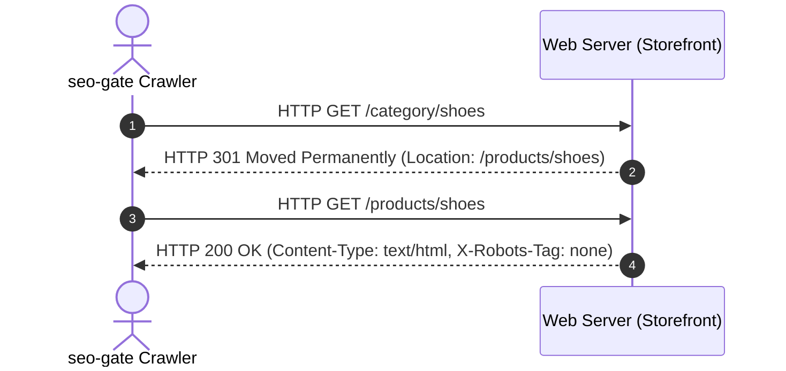

# HTTP Basics for SEO and CI/CD

## 1. In one paragraph
Hypertext Transfer Protocol (HTTP) is the foundational request-and-response protocol of the web, governing how clients (browsers and crawlers) request web documents and how web servers deliver status codes, metadata headers, and content.

## 2. Why this exists
Before a search engine or browser ever reads an HTML `<title>` tag, it evaluates the HTTP response status code and headers. If a server returns an HTTP 404 (Not Found), 500 (Internal Server Error), an endless redirect loop, or an `X-Robots-Tag: noindex` header, search engines will immediately drop or ignore the document. Understanding HTTP status codes, headers, and redirects is required to guard against silent deployment regressions.

## 3. How it works
Every HTTP interaction consists of a request and a response:
1. **Request:** The crawler sends a method (`GET`), a URL path, and request headers (such as `User-Agent` and `Accept`).
2. **Response Status Line:** The server returns a 3-digit numeric status code (e.g., `200 OK`, `301 Moved Permanently`, `404 Not Found`).
3. **Response Headers:** Key-value pairs delivering metadata about the payload (e.g., `Content-Type: text/html`, `X-Robots-Tag: noindex, nofollow`, `Location: /new-url`).
4. **Response Body:** The raw HTML, JSON, or media content.


*How to read this diagram: The crawler follows redirects to observe the final destination status and checks both intermediate headers and final payloads.*

### HTTP Status Code Categories
- **2xx (Success):** `200 OK` is the required baseline for indexable landing, product, and content pages.
- **3xx (Redirection):**
  - `301 Moved Permanently`: Permanent redirect (passes SEO equity).
  - `302 Found`: Temporary redirect (used for seasonal campaigns or regional routing).
  - **Redirect Chains:** When URL A redirects to B, which redirects to C, which redirects to D. Every hop slows page load and wastes search crawler crawl budget. Chains longer than 1 hop trigger warnings in `seo-gate`.
  - **Redirect Loops:** When URL A redirects to B and B redirects back to A, causing clients to fail with an error.
- **4xx (Client Errors):** `404 Not Found`, `410 Gone`. Broken links that destroy user trust and waste crawl budget.
- **5xx (Server Errors):** `500 Internal Server Error`, `502 Bad Gateway`, `503 Service Unavailable`. Indicates catastrophic server-side application failure.

### Key SEO Headers
- `X-Robots-Tag`: HTTP header equivalent to the HTML `<meta name="robots">` tag. It allows servers to disallow indexing on non-HTML files (like PDFs) or via global server configurations.
- `Location`: Directs the browser or crawler to the destination URL during a 3xx redirect.

## 4. Example
An HTTP response containing an accidental indexing blocker:
```http
HTTP/1.1 200 OK
Date: Sat, 21 Nov 2026 10:00:00 GMT
Content-Type: text/html; charset=UTF-8
X-Robots-Tag: noindex
Server: Apache

<!DOCTYPE html>
<html>
  <head><title>Black Winter Coat</title></head>
  <body>...</body>
</html>
```
Even though the HTML body is completely valid and lacks any `<meta name="robots">` tag, Googlebot will read `X-Robots-Tag: noindex` from the HTTP header and refuse to index this product page.

## 5. Salesforce analogy
In Salesforce integrations:
- A `200 OK` is like a successful REST callout or `Database.SaveResult.isSuccess() == true`.
- A `301/302 Redirect` is like an `ApexPages.StandardController.view()` redirect or an Experience Cloud URL Redirect Rule.
- A `404 Not Found` is like querying an `Id` that does not exist in the org (`List has no rows for assignment to SObject`).
- A `500 Server Error` is an unhandled `System.NullPointerException` or Apex CPU limit exceeded exception.
- `X-Robots-Tag` is like setting an Apex REST response header: `RestContext.response.addHeader('X-Robots-Tag', 'noindex')`.

## 6. Common mistakes and What to remember
- **Mistake:** Assuming that inspecting only `<head>` tags in HTML is sufficient to detect `noindex`. (Headers like `X-Robots-Tag` operate outside the HTML body).
- **Mistake:** Allowing multi-hop redirect chains (`/item` $\rightarrow$ `/item/` $\rightarrow$ `https://www.example.com/item/` $\rightarrow$ `/products/item`). Each hop adds latency.
- **Remember:** A 4xx or 5xx HTTP response on a designated critical page is an immediate build failure.
