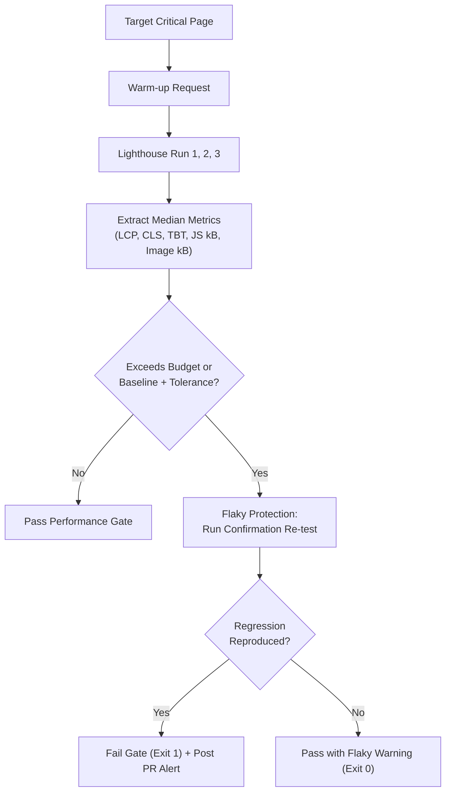

# Concepts: Lighthouse and Core Web Vitals (Lab vs. Field)

## 1. In one paragraph
Lighthouse is an automated performance audit tool that tests web pages in a controlled simulated environment to measure speed metrics like Largest Contentful Paint (LCP), Cumulative Layout Shift (CLS), and Total Blocking Time (TBT). In `seo-gate`, Lighthouse runs as a regression gate on pull requests to ensure new code does not make storefront pages noticeably slower or heavier before deploying to production.

## 2. Why this exists
Search engines like Google use page experience and Core Web Vitals as ranking signals. When developers add heavy JavaScript tracking tags, unoptimized hero banners, or unconstrained CSS animations, page load times balloon. Real users bounce and search rankings decline. Catching performance regressions before code merges is critical, but running audits in CI can be noisy. `seo-gate` provides reliable performance auditing with median averaging and flaky-test protection.

## 3. How it works
`seo-gate` audits key storefront pages (defined in `pages.critical`):
1. **Warm-Up Request:** Makes a preliminary request to prime the server and any edge caching.
2. **Fixed Audit Profile:** Launches Chromium with fixed CPU and network throttling profiles (simulated mobile 4G or desktop) so test conditions remain constant.
3. **Median of $N$ Runs (Default: 3):** Executes 3 independent runs and selects the median value for each metric (LCP, CLS, TBT, JS weight, Image weight).
4. **Budget Verification:** Compares the median against configured performance budgets (e.g. `lcpMs: 2500`).
5. **Baseline Diff & Flaky Protection:** Compares against the baseline snapshot. If a regression exceeds tolerance (default: 10%), `seo-gate` immediately triggers a confirmation run. Only if the regression reproduces does it fail the gate; otherwise, it is flagged as transient CI runner noise.


*How to read this diagram: Audits execute across multiple runs, calculate median metrics, test against budgets and baselines, and trigger confirmation runs to filter out transient CI runner jitter.*

## 4. Example
Lighthouse output captured in `RunResult` and `baseline.json`:
```json
{
  "performance": [
    {
      "url": "https://preview.example.com/",
      "runs": 3,
      "metrics": {
        "lcpMs": 1850,
        "cls": 0.04,
        "tbtMs": 120,
        "totalJsKb": 340,
        "totalImageKb": 620,
        "profile": "mobile-simulated"
      }
    }
  ]
}
```

Diff output when a developer merges an uncompressed 2MB hero image:
```
❌ Performance Regression:
   URL:             https://preview.example.com/
   Metric:          totalImageKb
   Baseline:        620 kB
   Current:         2620 kB (+322.5%)
   Budget:          1000 kB
   Tolerance:       10%
   Reproduced:      Yes (confirmed in re-run)
```

## 5. Salesforce analogy
Think of Lighthouse lab budgets like **Apex CPU Time and Heap Size Governor Limits**. In Salesforce, an Apex transaction fails if it exceeds 10,000ms CPU time or 6MB heap. Similarly, `seo-gate` fails a pull request if client-side rendering exceeds 2,500ms LCP or 500kB of JavaScript. Just as you test CPU limits in sandbox scratch orgs before production deployment, `seo-gate` tests lab performance budgets in preview environments.

## 6. Common mistakes and What to remember
- **Mistake:** Confusing **Lab Data** (Lighthouse simulated in CI) with **Field Data** (Chrome User Experience Report / CrUX from real users). Lab data is synthetic and deterministic for catching regressions; field data reflects real-world network and device variability over a 28-day window.
- **Mistake:** Running only a single Lighthouse run in CI. Shared GitHub Actions runners experience CPU throttling spikes, leading to false alarms. Always use median averaging ($N \ge 3$) and two-strike reproduction.
- **What to remember:** Always specify the audit profile (device, network speed, CPU throttling factor) in reports so developers understand the test conditions.
