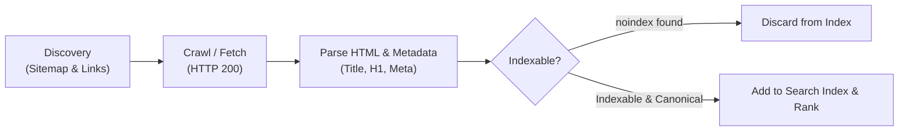

# SEO Basics for Developers

## 1. In one paragraph
Search Engine Optimization (SEO) is the technical discipline of structuring website HTML, metadata, and server responses so that automated search engine bots (like Googlebot) can discover, fetch, parse, and rank web pages for users.

## 2. Why this exists
Search engines do not use a website like human beings do; they rely on deterministic signals in the document's HTML. If a page is missing a `<title>`, has no `<h1>` heading, points to an invalid [canonical URL](file:///d:/seo-gate/docs/05-learning/glossary.md#canonical-url), or accidentally delivers a [noindex directive](file:///d:/seo-gate/docs/05-learning/glossary.md#noindex), search engines cannot index the page properly. When storefront or marketing pages lose indexability, the company loses organic search traffic, customer discovery, and direct revenue.

## 3. How it works
Search engine systems discover and index content across four distinct stages:
1. **Discovery:** The bot discovers new or updated URLs via internal links or XML sitemaps.
2. **Crawling (Fetching):** The bot issues an HTTP GET request to download the raw HTML response.
3. **Parsing & Rendering:** The bot inspects metadata tags (`<title>`, `<meta name="description">`, `<link rel="canonical">`, `<meta name="robots">`) and executes client-side JavaScript if needed.
4. **Indexing & Ranking:** The parsed text and signals are stored in the search index and ranked for relevant search queries.


*How to read this diagram: A page transitions through discovery and crawling before search engines parse its metadata. If a noindex signal is encountered, the document is discarded from the search index.*

### The Core HTML Signals Checked by `seo-gate`
- **Page Title (`<title>`):** The primary headline displayed in search engine result pages (SERPs) and browser tabs. Recommended length: 20 to 65 characters. Must be unique per page.
- **Meta Description (`<meta name="description" content="...">`):** A concise summary shown below the title in search results. Recommended length: 70 to 160 characters. Must be unique.
- **H1 Heading (`<h1>`):** The primary heading on the page conveying its main topic. Each page should contain exactly one `<h1>`.
- **Canonical URL (`<link rel="canonical" href="...">`):** The master or authoritative URL for a page, telling search engines which URL to rank when duplicate or parameterized URLs exist (e.g., tracking query parameters).
- **Robots Directives (`<meta name="robots" content="noindex">`):** Explicit instructions instructing crawlers whether to store the page in their index.

## 4. Example
A clean, indexable HTML document head:
```html
<!DOCTYPE html>
<html lang="en">
<head>
  <meta charset="utf-8">
  <title>Men's Waterproof Trail Running Shoes | Acme Outdoor</title>
  <meta name="description" content="Shop Acme Outdoor waterproof trail running shoes with rugged grip and breathable mesh. Free shipping on orders over $50.">
  <link rel="canonical" href="https://www.example.com/products/trail-shoes">
  <meta name="robots" content="index, follow">
</head>
<body>
  <h1>Men's Waterproof Trail Running Shoes</h1>
</body>
</html>
```

## 5. Salesforce analogy
In Salesforce, think of SEO metadata as **Object Definitions and Record Search Layouts**:
- The `<title>` is like the **Record Name (`Name`)** field that appears in global search results.
- The `<meta name="description">` is like the **Compact Layout secondary fields** that tell users what the record contains before clicking.
- The `<h1>` is the **Record Detail Primary Header** on a Lightning Record Page.
- The `canonical` tag is like the **Master Record ID** after merging duplicate Lead or Account records.
- The `noindex` tag is like unchecking **"Available in Public Knowledge Base"** or disabling public guest user sharing rules on an Experience Cloud Site.

## 6. Common mistakes and What to remember
- **Mistake:** Reusing the exact same title or description across thousands of product or category pages. Search engines penalize duplicate metadata.
- **Mistake:** Using relative URLs in canonical tags (e.g., `<link rel="canonical" href="/shoes">`). Canonical tags must always be absolute URLs including protocol and domain.
- **Remember:** A single accidental `<meta name="robots" content="noindex">` tag pushed to production will tell Google to delete that page from search results.
