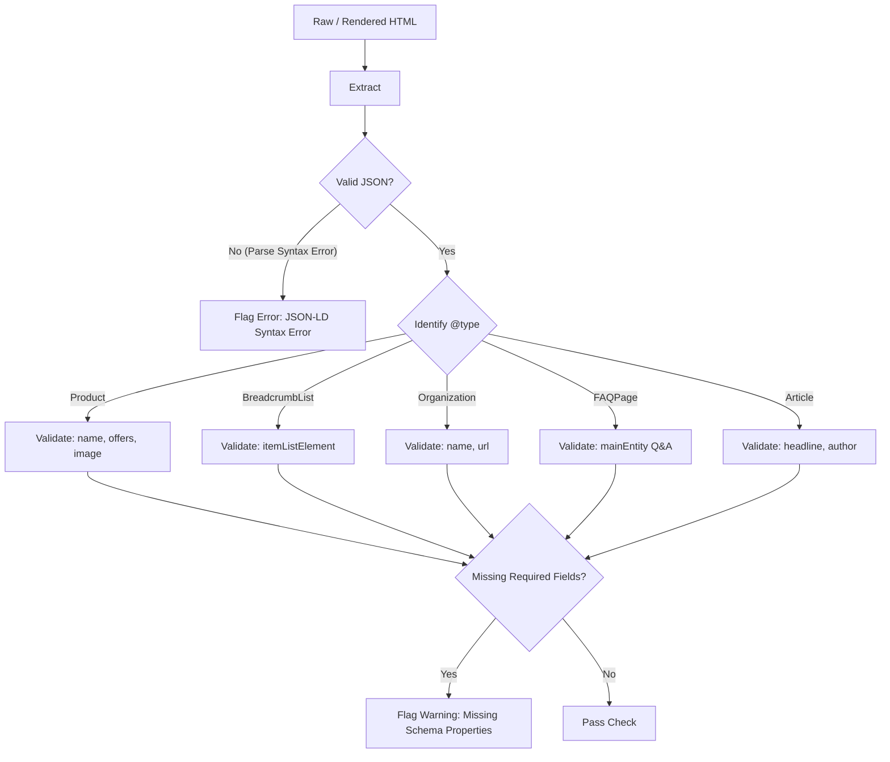

# Structured Data & JSON-LD for Search Engines

## 1. In one paragraph
Structured data is a standardized machine-readable format (most commonly JSON-LD inside `<script type="application/ld+json">`) that explicitly tells search engines what a web page represents—such as a product with prices and stock status, an article, an FAQ, or breadcrumbs.

## 2. Why this exists
Search engines are proficient at reading text, but determining whether a number like "$49.99" represents a sale price, shipping fee, or subscription cost requires ambiguity resolution. By embedding structured schema.org markup, storefronts become eligible for rich search results (rich snippets) with star ratings, pricing, availability badges, and review counts. If a pull request accidentally breaks or removes JSON-LD markup, the site loses rich snippet visibility and click-through rates plummet.

## 3. How it works
`seo-gate` inspects JSON-LD blocks across key schema types:
1. **Extraction:** Locates all `<script type="application/ld+json">` elements in the document.
2. **JSON Syntax Validation:** Parses the script text using `JSON.parse()`. Malformed JSON is immediately flagged as an error.
3. **Schema Type Evaluation:** Evaluates required properties for common schema.org types:
   - **`Product`:** Requires `name`, `description`, `image`, and `offers` (with `price` and `priceCurrency`).
   - **`BreadcrumbList`:** Requires `itemListElement` array with names and positions.
   - **`Organization`:** Requires `name` and `url`.
   - **`FAQPage`:** Requires `mainEntity` with question-and-answer pairs.
   - **`Article`:** Requires `headline`, `author`, and `datePublished`.
4. **Regression Diffing:** Flags any schema block that was present in the baseline but removed in the current pull request.


*How to read this diagram: Structured data scripts are extracted, validated for strict JSON syntax, and checked against type-specific required fields.*

## 4. Example
A valid Product schema markup:
```html
<script type="application/ld+json">
{
  "@context": "https://schema.org",
  "@type": "Product",
  "name": "Men's Waterproof Trail Running Shoes",
  "image": "https://example.com/images/shoes.jpg",
  "description": "Durable waterproof trail running shoes.",
  "offers": {
    "@type": "Offer",
    "price": "129.99",
    "priceCurrency": "USD",
    "availability": "https://schema.org/InStock"
  }
}
</script>
```

## 5. Salesforce analogy
In Salesforce terms:
- Structured data is like **API Schema Definitions and Custom Object Field-Level Metadata**.
- If an Apex REST endpoint promises an external consumer that an Account record payload contains `Name`, `BillingCity`, and `Active__c`, returning a payload missing those required keys breaks the integration contract. Similarly, structured data fulfills the contract between your storefront and Googlebot.

## 6. Common mistakes and What to remember
- **Mistake:** Trailing commas in JSON-LD. Browsers execute lenient JavaScript, but search engine JSON-LD parsers strictly follow JSON standards where trailing commas (`{ "name": "Shoe", }`) cause syntax errors.
- **Mistake:** Removing structured data during storefront frontend redesigns.
- **Remember:** Removing schema.org markup that existed in the baseline is treated as an immediate regression error.
