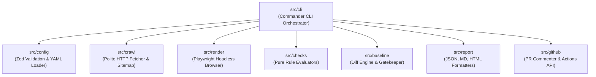

# System Design: Architecture & Module Guide

## 1. In one paragraph
`seo-gate` follows a strict, unidirectional layered architecture where network I/O, DOM parsing, rule checking, regression diffing, and report formatting are completely decoupled into dedicated modules with zero cyclic dependencies.

## 2. Why this exists
In complex CLI tools and testing engines, tight coupling creates bugs that are difficult to reproduce: crawlers making ad-hoc assertions, checks attempting network calls, or reporters modifying result payloads. By strictly separating concerns into isolated layers, every component can be tested independently with mock data, unit tests run in milliseconds without real HTTP servers, and the codebase remains simple for junior engineers and interview reviewers to reason about.

## 3. How it works
The architecture consists of clear modules with unidirectional dependencies:


*How to read this diagram: The CLI orchestrates the lifecycle. Arrows point in one direction only. Submodules never import each other or form circular dependency loops.*

### Strict Module Ownership & Invariants

| Module | Owns | Must NEVER Do |
|---|---|---|
| `src/config/` | Schema validation (`zod`), loading YAML/JSON, applying sensible defaults. | Never performs network calls; never decides build pass/fail. |
| `src/crawl/` | Discovering URLs, downloading sitemaps, making polite HTTP requests, parsing raw HTML. | Never evaluates SEO quality; never decides pass/fail. |
| `src/render/` | Headless Playwright browser management, DOM rendering after JavaScript execution. | Never performs SEO assertions; never modifies config. |
| `src/checks/` | Pure inspection of `PageAudit` input data; produces `Finding[]`. | **Never performs network calls; never reads files from disk.** |
| `src/baseline/` | Comparing current findings against a baseline snapshot; calculating regressions and exit code. | Never alters findings; never performs crawls. |
| `src/report/` | Transforming `RunResult` data into formatted JSON, Markdown, and HTML. | **Never alters or filters findings; formatting only.** |
| `src/github/` | Interacting with GitHub Actions environment, posting/updating sticky PR comments. | Never performs local checks or modifies result calculations. |

### Dependency Rules
1. **Unidirectional flow:** All dependencies flow from `cli` downward.
2. **Checks are pure functions:** `check(page: PageAudit, context: CheckContext): Finding[]`. Given identical input, a check must always return identical findings.
3. **Deterministic output:** All URL lists, findings, and JSON keys are alphabetically sorted before persistence or comparison.

## 4. Example
A clean architectural trace of executing a check:
1. `src/crawl/fetcher.ts` fetches `https://preview.example.com/shoes` and returns a `PageAudit` object.
2. `src/cli/runner.ts` passes the `PageAudit` object into `src/checks/title.ts`.
3. `src/checks/title.ts` evaluates the `<title>` tag and returns:
   ```typescript
   {
     checkId: "title",
     url: "https://preview.example.com/shoes",
     severity: "error",
     message: "Page title is missing",
     evidence: "<title></title>",
     fixHint: "Add a descriptive <title> tag between 20 and 65 characters to the <head> element.",
     docsLink: "https://developers.google.com/search/docs/appearance/title-link"
   }
   ```
4. `src/baseline/diff.ts` checks whether this finding existed in `baseline.json`. If not, it marks it as a `regression`.
5. `src/report/json.ts` serializes the run into standard JSON.

## 5. Salesforce analogy
In Salesforce development:
- **`src/config`** $\approx$ **Custom Metadata Type (`SeoGate_Setting__mdt`)**: Defines validated thresholds and options.
- **`src/crawl`** $\approx$ **Inbound REST Callout Service**: Retrieves raw external data payloads.
- **`src/checks`** $\approx$ **Apex Validation Rules & Unit Test Assertions**: Pure logic that inspects data in memory and flags errors without performing DML or callouts.
- **`src/baseline`** $\approx$ **Metadata Comparison Engine**: Compares changes between your local feature branch and the `main` org branch.
- **`src/report`** $\approx$ **Visualforce / Lightning Report Builder**: Formats results for humans without changing the underlying records.

## 6. Common mistakes and What to remember
- **Mistake:** Allowing a check in `src/checks/` to fetch a URL using `fetch()`. (If a check makes network calls, unit testing requires network access and tests become flaky and slow).
- **Mistake:** Letting the crawler fail the build directly when a 404 occurs. (The crawler only records the status code; the `http-status` check in `src/checks/` evaluates whether it violates policy).
- **Remember:** Zero cyclic dependencies; pure check functions; deterministic sorted outputs.
