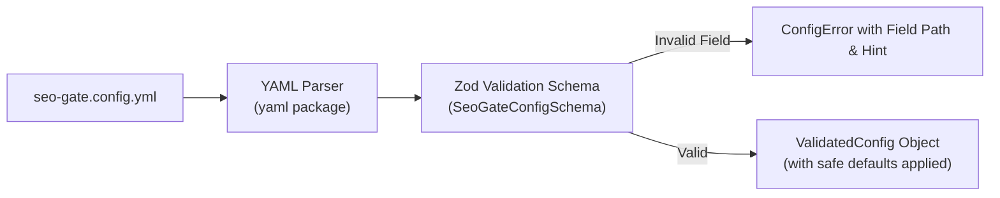

# System Design: Configuration Architecture

## 1. In one paragraph
`seo-gate.config.yml` is the declarative configuration contract that governs how `seo-gate` crawls sites, enforces rules, applies overrides, sets performance budgets, and honors documented ignore exceptions. It is strictly validated at runtime using Zod to catch configuration mistakes immediately.

## 2. Why this exists
In enterprise multi-team environments, both software engineers and non-developer SEO specialists need to inspect and adjust configuration without modifying TypeScript code. If a configuration file is poorly structured or provides cryptic runtime errors, adoption stalls. `seo-gate` uses a human-readable YAML file with safe defaults, strict schema validation, and helpful error messages.

## 3. How it works
Configuration parsing follows a three-step validation pipeline:


*How to read this diagram: Raw YAML is parsed and strictly validated against Zod schemas; default values fill optional parameters, and errors produce precise field paths.*

### Complete Configuration Schema Reference

```yaml
# Target environment (Required)
target: https://preview-123.example.com
production: https://www.example.com      # Optional: for cross-environment comparisons

# Operational gate mode: strict | regression | report
mode: regression

# Page discovery rules
pages:
  include: ["/", "/products/*", "/category/*"]
  exclude: ["/cart", "/account/*", "/checkout/*"]
  sitemap: true                          # boolean or custom sitemap URL
  crawl:
    maxPages: 100
    maxDepth: 3
    concurrency: 4
    delayMs: 100
  critical: ["/", "/products/flagship"]  # Critical pages receiving Playwright + Lighthouse

# Check configuration rules
checks:
  title: { min: 20, max: 65, unique: true }
  metaDescription: { min: 70, max: 160, unique: true }
  h1: { requireExactOne: true }
  canonical: { requireSelfReferencing: true }
  noindex: { allowOnStaging: false }
  renderedVsRaw: { critical: ["h1", "title", "canonical"] }
  structuredData: { requiredTypes: ["Product", "BreadcrumbList", "Organization", "FAQPage", "Article"] }
  hreflang: { requireSelfReferencing: true, requireReciprocal: true }
  sitemap: { maxDropPercent: 10 }
  robotsTxt: { disallowRootOnError: true }

# Lab performance budgets (Lighthouse)
budgets:
  lcpMs: 2500
  cls: 0.1
  tbtMs: 300
  totalJsKb: 500
  totalImageKb: 1000
  tolerancePercent: 10
  runs: 3
  profile: mobile

# Custom severity overrides
severity_overrides:
  title-length-short: warn
  structured-data-missing-field: warn

# Documented exceptions (Every ignore REQUIRES a reason)
ignore:
  - check: title-length-short
    url: /legal/*
    reason: "Legal disclaimer pages use fixed legal headers approved by counsel"
    expires: "2027-06-30"
```

### Key Design Rules for Configuration
1. **Mandatory Reasons on Ignores:** Every `ignore` entry requires a documented `reason`. Blank reasons fail schema validation.
2. **Optional Expiration Dates:** Ignores may declare an `expires: "YYYY-MM-DD"`. Once expired, `seo-gate` automatically resumes flagging the issue.
3. **Safe Defaults Everywhere:** Every sub-block has safe defaults; a minimal config with only `target` and `pages.include` is fully functional.

## 4. Example
A clear human error produced when a user misspells a configuration property:
```
❌ Configuration Error:
Field 'budgets.lcpMs': Expected number, received string 'fast'
👉 Please correct seo-gate.config.yml and re-run.
```

## 5. Salesforce analogy
`seo-gate.config.yml` is like a **Salesforce Custom Metadata Type or Custom Setting**. It decouples runtime behavior and business rules from the underlying execution code, allowing administrators and specialists to adjust thresholds without deploying new Apex code.

## 6. Common mistakes and What to remember
- **Mistake:** Putting trailing asterisks in page paths without understanding pattern matching (`/category/*` matches `/category/shoes`, but not `/category`).
- **Mistake:** Forgetting that `mode: regression` requires a `baseline.json` file. If none exists, `seo-gate` evaluates strict mode for newly encountered errors.
- **What to remember:** Always run `seo-gate init` to generate a known-good starter configuration.
