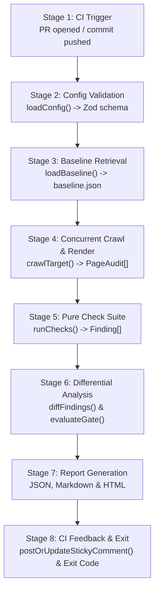

# System Design: End-to-End Data Flow

## 1. In one paragraph
This document traces the complete lifecycle of a single pull request run through `seo-gate`, mapping how data transitions from an ephemeral staging preview URL into crawled DOM snapshots, pure check inspection findings, baseline diff comparisons, and final pull request comments.

## 2. Why this exists
Understanding data flow is essential for debugging and technical interview explanations. When troubleshooting why a specific error occurred or explaining how ephemeral preview URLs match production baselines, tracing the data transformation steps through exact modules and functions removes all ambiguity.

## 3. How it works
The execution lifecycle follows an eight-stage unidirectional data transformation pipeline:


*How to read this diagram: Data transforms sequentially from external CI inputs down to structured reports and exit codes without circular dependencies.*

### Step-by-Step Execution Sequence

1. **Stage 1: CI Trigger (`.github/workflows/seo-gate-pr.yml`):**
   - GitHub Actions triggers on `pull_request` events.
   - The user's preview deployment step provisions a temporary URL (e.g. `https://preview-42.example.com`).
   - The composite action `action.yml` invokes `seo-gate run --config seo-gate.config.yml --baseline baseline.json --pr 42`.
2. **Stage 2: Configuration Ingestion (`src/config/loader.ts`):**
   - Reads `seo-gate.config.yml`.
   - Zod schema `SeoGateConfigSchema` validates targets, page include/exclude patterns, check options, and ignore rules.
   - Throws human-readable `ConfigError` naming bad fields if invalid.
3. **Stage 3: Baseline Retrieval (`src/baseline/storage.ts`):**
   - Loads `baseline.json` from git repository.
   - Validates `schemaVersion: 1` and parses prior `Finding[]` and `PagePerformanceAudit[]`.
4. **Stage 4: Crawl & Selective Rendering (`src/crawl/fetcher.ts` & `src/render/browser.ts`):**
   - `fetchPage` tests root reachability (fails fast if preview is down).
   - Polite queue discovers URLs from `pages.include` and `pages.sitemap`.
   - Critical pages in `pages.critical` are hydrated in headless Playwright Chromium (with non-essential media/CSS aborted).
   - Produces an array of `PageAudit` objects.
5. **Stage 5: Pure Check Suite (`src/checks/runner.ts`):**
   - Iterates through 11 pure checks in `src/checks/registry.ts`.
   - Emits raw findings, applies `severity_overrides`, and filters active `ignore` rules with unexpired dates.
   - Produces `Finding[]`.
6. **Stage 6: Differential Analysis (`src/baseline/diff.ts`):**
   - Converts each finding into host-agnostic fingerprints (`${checkId}::${pathname}`).
   - Partitions findings into `newFindings`, `resolvedFindings`, and `unchangedFindings`.
   - Evaluates gate decision: in `regression` mode, fails only on new errors vs. baseline.
7. **Stage 7: Multi-Format Reporting (`src/report/`):**
   - `json.ts` writes `schemaVersion: 1` machine-readable results.
   - `markdown.ts` constructs the PR summary table with collapsible sections.
   - `html.ts` generates a standalone interactive single-file dashboard.
8. **Stage 8: GitHub Sync & Exit (`src/github/comment.ts` & `src/cli/commands.ts`):**
   - Searches PR for existing `<!-- seo-gate-sticky-comment -->` marker.
   - Updates via `PATCH` if found, or creates via `POST` if new.
   - Returns exit code: `0` (pass), `1` (gate failed), `2` (tool/config error).

## 4. Example
Data transformation of a single finding from HTML to GitHub PR comment:
```
1. Raw HTML fetched:
   <meta name="robots" content="noindex, follow">

2. Pure Check (src/checks/noindex.ts):
   Emits Finding: { checkId: 'noindex-meta', url: 'https://preview-42.example.com/pricing', severity: 'error' }

3. Fingerprint (src/baseline/diff.ts):
   Fingerprint: "noindex-meta::/pricing"

4. Diff Engine:
   Fingerprint not in baseline.json -> Classified as NEW REGRESSION.

5. Sticky Comment (src/github/comment.ts):
   Appends to PR table:
   | `noindex-meta` | [/pricing](https://preview-42.example.com/pricing) | Page contains noindex directive | Remove noindex from meta tag |
```

## 5. Salesforce analogy
This data flow mirrors a **Salesforce Change Set or Metadata Deployment Pipeline**:
- Target URL = **Scratch Org / Sandbox Org**
- Baseline = **Production Org Metadata Snapshot**
- Pure Checks = **Apex Test Methods & Field Validation Rules**
- Diff Engine = **Metadata Comparison Tool (identifying newly modified vs existing components)**
- Exit Code = **Deployment Status (`Success` vs `Validation Failure`)**

## 6. Common mistakes and What to remember
- **Mistake:** Allowing checks to make ad-hoc network calls during execution. Checks must remain pure functions operating on pre-fetched `PageAudit` data.
- **Mistake:** Comparing full URLs with hostnames in the diff stage. Ephemeral preview hostnames change on every pull request, which would cause every page to look like a new regression.
- **What to remember:** Data flows strictly one way: External Input $\rightarrow$ Ingestion $\rightarrow$ Crawl $\rightarrow$ Pure Checks $\rightarrow$ Diff $\rightarrow$ Reports $\rightarrow$ Exit.
