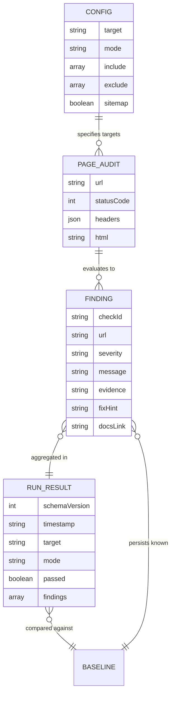

# System Design: Data Model & Schema Specifications

## 1. In one paragraph
`seo-gate` relies on strongly typed TypeScript interfaces and Zod schemas for all configurations, intermediate page audits, findings, and JSON run outputs, versioned via `schemaVersion: 1` to guarantee backward compatibility and deterministic CI automation.

## 2. Why this exists
In automated CI/CD tools, if the output data structure changes unexpectedly, downstream tools (such as GitHub Actions PR commenters, Slack webhooks, or company reporting dashboards) break. By explicitly defining schemas using Zod and providing versioned structures, any invalid configuration is rejected with human-friendly errors before crawling begins, and all output consumers receive predictable, deterministic JSON.

## 3. How it works
The system revolves around four core data entities:
1. **Config (`SeoGateConfig`):** The validated user configuration parsed from `seo-gate.config.yml`.
2. **PageAudit (`PageAudit`):** The extracted snapshot of a single page (status, headers, Cheerio `$`, canonical, title, etc.).
3. **Finding (`Finding`):** An individual SEO problem detected on a specific URL.
4. **RunResult (`RunResult`):** The complete output summary of a run, containing findings, page counts, metadata, and regression status.


*How to read this diagram: The Config drives PageAudits, which evaluate into Findings. Findings are aggregated into a versioned RunResult and compared against Baseline snapshots.*

### Field-by-Field Specifications

#### 1. Finding Schema
Every check outputs findings conforming to this exact structure:
```typescript
interface Finding {
  /** Unique identifier of the check (e.g., 'noindex', 'canonical-missing', 'title-length') */
  checkId: string;
  /** The normalized URL where the finding occurred */
  url: string;
  /** Finding severity level: 'error' (fails gate in strict mode), 'warn', or 'info' */
  severity: "error" | "warn" | "info";
  /** Concise plain-English explanation of the issue */
  message: string;
  /** The exact HTML tag, HTTP header, or attribute value that triggered the check */
  evidence: string;
  /** Concrete, actionable advice explaining how a developer can fix the issue */
  fixHint: string;
  /** Link to official search engine documentation or internal runbook */
  docsLink: string;
}
```

#### 2. RunResult Schema (`schemaVersion: 1`)
```typescript
interface RunResult {
  /** Schema contract version */
  schemaVersion: 1;
  /** ISO 8601 UTC timestamp of execution */
  timestamp: string;
  /** Target base URL */
  target: string;
  /** Gate execution mode: 'strict', 'regression', or 'report' */
  mode: "strict" | "regression" | "report";
  /** Overall pass/fail outcome for CI exit code determination */
  passed: boolean;
  /** Execution summary metrics */
  summary: {
    totalPages: number;
    errors: number;
    warnings: number;
    info: number;
    regressions: number;
  };
  /** All detected findings, sorted deterministically by URL then checkId */
  findings: Finding[];
  /** New findings detected during regression comparison (empty in strict/report modes) */
  regressions?: Finding[];
}
```

### Schema Versioning & Migrations
- The root document includes `schemaVersion: 1`.
- Any non-breaking field additions (e.g., adding an optional `durationMs` field) maintain `schemaVersion: 1`.
- Any breaking rename or removal of fields will increment to `schemaVersion: 2`, accompanied by an automated migration helper in `src/baseline/migrate.ts`.

## 4. Example
A serialized `RunResult` JSON output:
```json
{
  "schemaVersion": 1,
  "timestamp": "2026-11-21T10:15:00.000Z",
  "target": "https://preview.example.com",
  "mode": "regression",
  "passed": false,
  "summary": {
    "totalPages": 3,
    "errors": 1,
    "warnings": 1,
    "info": 0,
    "regressions": 1
  },
  "findings": [
    {
      "checkId": "noindex",
      "url": "https://preview.example.com/products/boots",
      "severity": "error",
      "message": "Page contains a noindex directive but is configured to be indexable",
      "evidence": "<meta name=\"robots\" content=\"noindex\">",
      "fixHint": "Remove 'noindex' from the meta robots tag or X-Robots-Tag HTTP header before production deployment.",
      "docsLink": "https://developers.google.com/search/docs/crawling-indexing/block-indexing"
    },
    {
      "checkId": "title",
      "url": "https://preview.example.com/about",
      "severity": "warn",
      "message": "Title is shorter than 20 characters (currently 8 characters)",
      "evidence": "<title>About Us</title>",
      "fixHint": "Expand the title tag to between 20 and 65 characters to improve search click-through rate.",
      "docsLink": "https://developers.google.com/search/docs/appearance/title-link"
    }
  ],
  "regressions": [
    {
      "checkId": "noindex",
      "url": "https://preview.example.com/products/boots",
      "severity": "error",
      "message": "Page contains a noindex directive but is configured to be indexable",
      "evidence": "<meta name=\"robots\" content=\"noindex\">",
      "fixHint": "Remove 'noindex' from the meta robots tag or X-Robots-Tag HTTP header before production deployment.",
      "docsLink": "https://developers.google.com/search/docs/crawling-indexing/block-indexing"
    }
  ]
}
```

## 5. Salesforce analogy
In Salesforce terms:
- `SeoGateConfig` is like a **Custom Metadata Type Definition (`SeoGate_Rule__mdt`)**.
- `PageAudit` is like an in-memory **SObject Instance (`Page_Audit__c`)** instantiated in Apex before committing or firing triggers.
- `Finding` is like a **`Database.Error`** record returned by `record.addError()` or a test assertion failure.
- `RunResult` is like an **`ApexTestRunResult`** record that captures test run timestamp, total tests passed, failed methods, and execution status.

## 6. Common mistakes and What to remember
- **Mistake:** Emitting un-sorted findings. If findings are output in non-deterministic order (e.g., depending on which asynchronous network request finished first), `git diff` produces noisy diffs every run.
- **Mistake:** Changing field names in JSON reports without bumping `schemaVersion`.
- **Remember:** Findings are always sorted alphabetically by URL, then by `checkId`.
