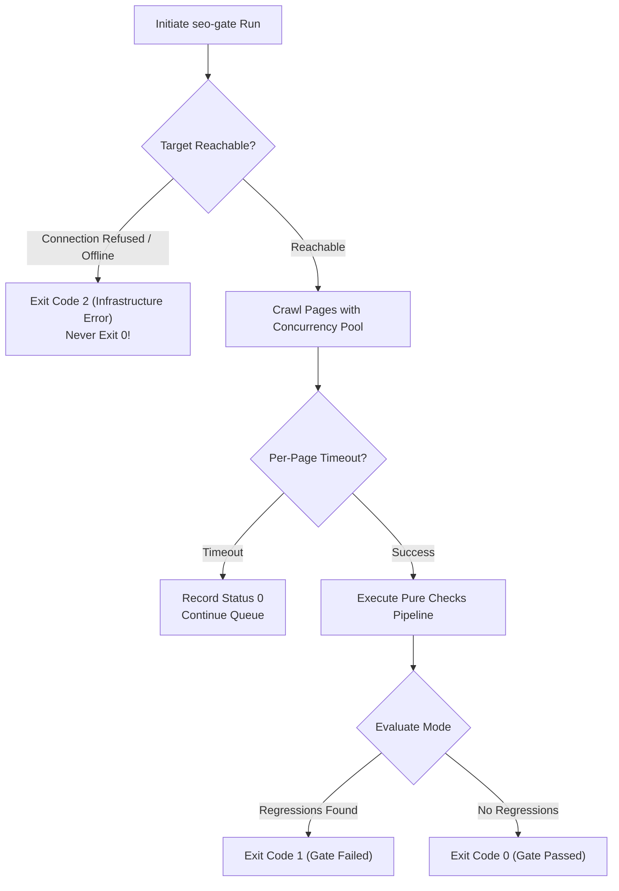

# System Design: Failure Modes & Reliability Engineering

## 1. In one paragraph
This document details how `seo-gate` detects, isolates, and recovers from runtime failures—including unreachable preview environments, network timeouts, rate limit throttling, malformed markup, and circular redirects—ensuring deterministic CI execution.

## 2. Why this exists
In CI/CD environments, false positives (failing a build when the code is fine) alienate developers, while false negatives (passing a build when tests didn't actually run) destroy trust in the safety net. If a target preview server is offline, exiting with code `0` because "zero errors were detected" would allow broken deployments into production. Robust systems anticipate every potential failure mode and define exact, deterministic behavior for each.

## 3. How it works

### Comprehensive Failure Modes Matrix

| Failure Mode | Detection Mechanism | Immediate System Action | Exit Code |
|---|---|---|---|
| **Preview Server Not Ready / Offline** | Root fetch fails with connection error (`ECONNREFUSED`, `ENOTFOUND`). | Aborts crawl immediately with descriptive error: `Could not reach ${target}. Is the preview URL correct?` | **`2`** (Tool Error) |
| **Request Timeout** | `AbortController.signal` fires after timeout threshold (default: 15s). | Records status code `0`, logs timeout failure for that URL, does not hang indefinitely. | **`1`** (or **`2`** if root) |
| **HTTP 429 Too Many Requests** | Receives HTTP status 429 from preview or staging server. | Throttles crawler, warns on concurrency; flags as HTTP client error. | **`1`** |
| **Circular Redirect Loop** | Tracked URL appears more than once in `redirectChain`. | Breaks loop immediately (stops following), flags `http-redirect-loop` error. | **`1`** |
| **Multi-Hop Redirect Chain** | `redirectChain.length > 2` (> 1 hop). | Records final destination, flags `http-redirect-chain` warning. | **`0`** (Warn) |
| **Invalid Config YAML** | Zod safeParse failure. | Prints exact field path and human-friendly remediation message. | **`2`** (Config Error) |
| **Missing Baseline File** | `fs.existsSync(baselinePath)` returns false. | In `regression` mode, falls back safely to evaluating current errors. | **`1`** / **`0`** |
| **Malformed JSON-LD** | `JSON.parse` throws SyntaxError on structured data block. | Catches exception, captures exact script text, flags `structured-data-syntax` error. | **`1`** |
| **JavaScript Storefront Only (No Raw Content)** | Raw HTML missing title or H1 while Playwright rendered DOM contains it. | Compares raw vs rendered snapshots; flags `rendered-vs-raw-critical` regression. | **`1`** (or Warn) |


*How to read this diagram: Infrastructure unreachability routes directly to exit code 2. Only healthy crawls proceed to SEO check evaluation and gate decisions.*

## 4. Example
Terminal output when an ephemeral preview deployment is not ready:
```text
$ pnpm seo-gate run --config seo-gate.config.yml
🔍 seo-gate: Initializing run with config: seo-gate.config.yml...
   Target: https://preview-102.store.app [Mode: regression]
   Crawling target pages and verifying reachability...

❌ Crawl Error: Could not reach https://preview-102.store.app (timeout or connection error). Is the preview URL correct?
Exit code: 2
```

## 5. Salesforce analogy
In Salesforce integrations:
- Exit Code `2` on an unreachable target is like receiving a **`CalloutException: Unauthorized endpoint` or `System.CalloutException: Read timed out`**—you cannot proceed with data processing because the remote system failed to respond.
- The redirect loop breaker is like the **Governor Limit preventing recursive trigger loops** (`System.LimitException: Maximum trigger depth exceeded (16)`).

## 6. Common mistakes and What to remember
- **Mistake:** Catching an unreachable target exception and returning an empty list of findings, which leads to a false-positive passing build.
- **Mistake:** Unbounded timeouts that cause CI runners to hang for hours.
- **Remember:** An unreachable target must **never** produce a passing result (Exit Code `0`).
