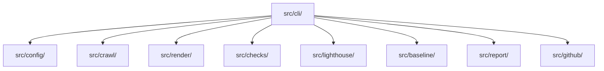

# System Design: Module Guide & Ownership Rules

## 1. In one paragraph
This document defines the ownership boundaries, interfaces, and strict dependency rules for every module in `seo-gate`, ensuring that the codebase remains maintainable, modular, and completely free of circular dependencies.

## 2. Why this exists
In growing software projects, boundaries erode over time: crawlers start evaluating business logic, checks begin making HTTP requests, and formatters mutate results. Having explicit ownership contracts and negative constraints ("what this module must never do") prevents architectural decay and makes the system easy to explain in technical interviews.

## 3. Module Ownership Matrix

*How to read this diagram: All dependencies point strictly inward from the CLI orchestration layer. Sub-packages never import CLI, and checks never perform I/O.*

### Ownership and Constraints

| Module | What it Owns | What it Must NEVER Do |
|---|---|---|
| `src/types.ts` | Foundational data contracts (`Finding`, `PageAudit`, `SeoGateConfig`, `RunResult`). | Must never import from other modules or contain runtime logic. |
| `src/config/` | Reading YAML/JSON, Zod schema validation, default values, starter config generator. | Must never crawl URLs, make network calls, or evaluate findings. |
| `src/crawl/` | HTTP fetching, redirect chain tracking, URL normalization, sitemap parsing. | Must never decide pass/fail, evaluate rules, or write reports. |
| `src/render/` | Playwright Chromium lifecycle, resource interception, hydration DOM extraction. | Must never evaluate SEO rules or access disk baselines. |
| `src/checks/` | Pure rule inspection on HTML/headers/DOM, severity overrides, active ignore filtering. | **Must NEVER perform network or file I/O.** Must remain 100% side-effect-free pure functions. |
| `src/lighthouse/` | Chrome DevTools Protocol session, median-of-N averaging, two-strike flaky protection. | Must never make Git commits or post PR comments. |
| `src/baseline/` | Baseline serialization, file I/O, finding fingerprinting, three-way diff partitioning, gate mode evaluation. | Must never crawl pages or format HTML/Markdown reports. |
| `src/report/` | Generating JSON, Markdown, and HTML reports, sending Slack/Teams webhooks. | Must never modify findings or change gate pass/fail decisions. |
| `src/github/` | GitHub REST API interactions, sticky PR comment searching, creating (`POST`), and patching (`PATCH`). | Must never evaluate gate rules or modify baseline files. |
| `src/cli/` | Commander commands (`init`, `run`, `baseline update`, `diff`), terminal styling, process exit codes. | Must never contain core inspection or diff logic directly. |

## 4. Example
A violation of module boundaries and how it was prevented:
- **Bad Design:** `src/checks/canonical.ts` performs a `fetch(canonicalUrl)` to verify if the canonical target returns HTTP 200.
  - *Why this is bad:* Checks become slow, prone to network timeouts, hard to unit test, and impossible to run deterministically on offline fixtures.
- **Clean seo-gate Design:** `src/crawl/fetcher.ts` fetches all pages upfront into a lookup map. `src/checks/canonical.ts` receives `context.allPages` and looks up the status code in memory as a pure function.

## 5. Salesforce analogy
Think of these module boundaries like **Salesforce Enterprise Architecture layers**:
- `src/types.ts` = **SObject Schema & Custom Object Definitions**
- `src/crawl/` & `src/render/` = **Integration Layer (REST/SOAP Callouts)**
- `src/checks/` = **Domain Layer / Service Layer (Pure Business Logic)**
- `src/report/` = **Presentation Layer (Visualforce / LWC UI)**
- `src/cli/` = **Controller Layer / REST Resource**

## 6. Common mistakes and What to remember
- **Mistake:** Importing `cli/` inside any lower-level package. Lower-level packages must be reusable as a standalone Node.js library without CLI dependencies.
- **What to remember:** If a check needs external data, that data must be gathered during the crawl stage and passed in via `CheckContext`.
