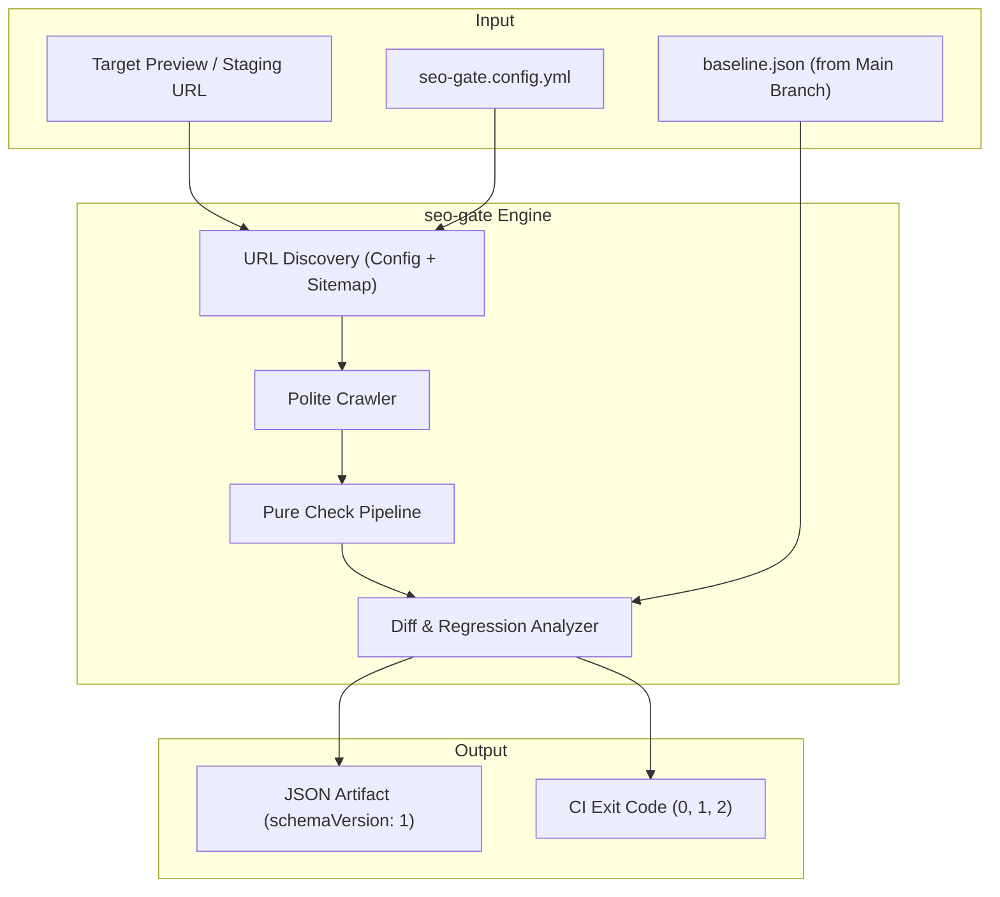

# System Design: Overview

## 1. In one paragraph
**seo-gate** is an automated SEO regression testing tool designed for CI/CD pipelines that inspects web storefronts and web applications against saved baselines, alerting teams or blocking pull requests when changes break SEO contracts.

## 2. Why this exists
Development teams shipping e-commerce storefronts (including Salesforce Commerce Cloud, Experience Cloud, and modern web frameworks) move quickly. In rapid sprint cycles, changes in components, templates, or router configurations can inadvertently remove canonical tags, drop `<title>` elements, break redirect rules, or introduce `noindex` directives. Because these issues rarely break visual layout or functional checkout tests, they silently slip into production, resulting in devastating organic traffic and revenue loss before anyone notices. `seo-gate` provides an automated guardrail before deployment.

## 3. How it works
`seo-gate` runs as a CLI command or GitHub Action during CI/CD execution:
1. It ingests configuration from `seo-gate.config.yml`.
2. It discovers the target page set via explicit URL lists and XML sitemaps.
3. It crawls the target site using a polite, bounded concurrency pool.
4. It executes pure, isolated SEO checks against each page's status, headers, and DOM.
5. In `regression` mode, it loads a previously committed `baseline.json`, compares findings, and fails the build only if new errors have been introduced.
6. It writes a structured JSON report (and in subsequent phases, Markdown and HTML reports).


*How to read this diagram: System inputs (URLs, config, and baseline) are ingested by the engine, processed through discovery, crawling, checking, and regression diffing, producing structured JSON and an exit code.*

### Target Users
- **Salesforce Developers (7 users):** Building Experience Cloud and B2B Commerce storefronts; need deterministic pass/fail results integrated into GitHub Actions without learning deep SEO nuance.
- **Full-Stack Developers (3 users):** Building custom frontends, Node backends, and APIs; need clean CLI execution and fast local testing.
- **SEO Specialists (3 users):** Non-engineers who define title/description length rules, review PR reports, manage baseline exceptions, and configure severity overrides.

### Goals
- Run automatically in CI/CD on pull requests and deployments.
- Catch 100% of planted indexability and metadata regressions in preview environments.
- Provide clear, actionable remediation hints for every finding.
- Complete 100-page crawl and audits within under 10 minutes in CI runners.

### Non-Goals
- No rank tracking, keyword difficulty research, or paid SERP scraping APIs.
- No unauthorized scraping of third-party domains.
- Not a replacement for Google Search Console or real-user field Core Web Vitals monitoring.

### Success Metrics
- **Regressions Caught:** Number of accidental `noindex`, missing canonical, or broken status code issues blocked before production.
- **False Positive Rate:** < 1% false alerts on stable preview deployments.
- **Run Time:** < 60 seconds for 20 pages; < 10 minutes for 100 pages in standard GitHub Actions runners.

## 4. Example
A typical developer terminal invocation:
```bash
$ npx seo-gate run --config seo-gate.config.yml --mode regression --baseline baseline.json
🔍 Starting seo-gate run against https://preview-42.example.com...
📄 Discovered 5 pages to audit
  ✓ [200] / (Index)
  ✓ [200] /products/hiking-boots
  ✗ [200] /products/trail-shoes (1 error: accidental noindex)
  ✓ [200] /category/footwear
  ✓ [200] /about

Gate check failed: 1 new regression detected vs baseline.
Exit code: 1
```

## 5. Salesforce analogy
In Salesforce terms:
- `seo-gate` is your **Automated Deployment Validation Gate** (equivalent to running `sf project deploy start --dry-run --test-level RunLocalTests`).
- The `baseline.json` is a **Snapshot of your Staging Org's Known Test Results**.
- If a developer introduces a new validation error or broken test that did not exist in the baseline, the deployment fails with a detailed stack trace and fix hint.

## 6. Common mistakes and What to remember
- **Mistake:** Confusing `seo-gate` with a live rank tracker (like Ahrefs or Semrush). `seo-gate` verifies code contracts, not external Google ranking algorithms.
- **Mistake:** Running against production without setting `mode: report` during initial onboarding.
- **Remember:** In `regression` mode, existing known issues in baseline do not block the build; only new regressions fail the gate.
