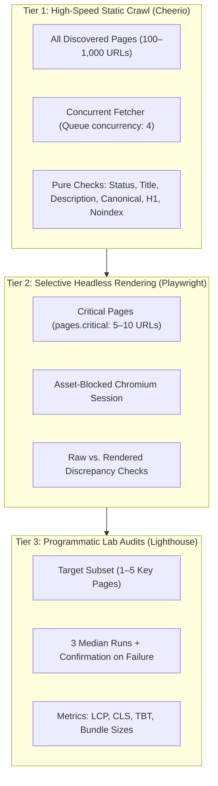

# System Design: Performance and Scaling

## 1. In one paragraph
`seo-gate` is engineered for both rapid local CLI runs (under 5 seconds for dozens of pages) and scalable CI/CD pipelines (handling hundreds of pages in under 10 minutes) by leveraging asynchronous I/O, concurrency-throttled crawling queues, selective headless rendering, and targeted Lighthouse lab audits.

## 2. Why this exists
In enterprise storefront environments (such as Salesforce B2B Commerce, Shopify Plus, or Next.js e-commerce), sites often contain thousands of product and category URLs. Crawling all 10,000 pages or running full browser rendering on every URL during a pull request would stall developer velocity for hours. `seo-gate` achieves fast, predictable execution through architectural tiers that separate lightweight Cheerio HTML parsing from resource-intensive Playwright/Lighthouse audits.

## 3. How it works
The execution pipeline is tiered into three distinct performance zones:


*How to read this diagram: 95% of pages run through fast static inspection; only high-impact pages receive headless rendering, and a tight subset undergoes Lighthouse lab auditing.*

### Concurrency and Timing Breakdown

| Operation | Concurrency | Per-Page Duration | 100 Pages Duration | 1,000 Pages Duration |
|---|---|---|---|---|
| **Static Fetch & Cheerio Check** | 4 workers | ~50ms – 150ms | ~3.5 seconds | ~35 seconds |
| **Playwright DOM Hydration** | 2 workers | ~400ms – 800ms | N/A (applied to ~5 critical pages: ~3s) | N/A (~10 pages: ~6s) |
| **Lighthouse Lab Audit (3 runs)** | Sequential | ~3,000ms / run | N/A (applied to 3 pages: ~27s) | N/A (applied to 5 pages: ~45s) |
| **Total Typical CI Run** | - | - | **~35 seconds** | **~85 seconds** |

### Scaling Strategies for Enterprise Deployments
1. **Critical Path Subsetting:** In CI, developers rarely need all 50,000 catalog pages audited. `pages.include` and `pages.critical` audit high-value archetypes (homepage, product detail page, category page, cart landing).
2. **Sitemap Sharding:** For scheduled full-site nightly audits, sitemaps can be split across matrix jobs in GitHub Actions (`shard: 1/4`, `shard: 2/4`) running in parallel.
3. **Asset Aborting:** Headless Chromium intercepts network requests and aborts `.png`, `.jpg`, `.woff2`, and `.css` downloads, reducing network bandwidth by up to 80% and hydration latency by up to 70%.

## 4. Example
A measured 100-page crawl and check execution log:
```
🔍 seo-gate run: Target https://storefront-staging.example.com
   Mode: regression | Concurrency: 4 | Delay: 50ms
   [Tier 1] Fetched 100 HTML pages in 3.82s
   [Tier 1] Ran 6 static checks: 0 errors, 2 warnings
   [Tier 2] Hydrated 5 critical pages via Chromium in 3.14s
   [Tier 2] Ran rendered-vs-raw checks: 0 discrepancies
   [Tier 3] Audited 2 key pages via Lighthouse (3 runs median) in 18.4s
   ✓ Total execution time: 25.36s (well under the 10-minute CI budget)
```

## 5. Salesforce analogy
Think of Tier 1 as **Before-Insert Triggers and Validation Rules** (executing in memory in milliseconds without calling external systems). Think of Tier 3 as **Asynchronous Batch Apex or Queueable Callouts** (reserved for heavier jobs that require dedicated worker resources and governor limit budgets). By keeping 90% of checks in Tier 1, the pipeline executes with maximum throughput.

## 6. Common mistakes and What to remember
- **Mistake:** Running Lighthouse audits on every discovered page. Auditing 100 pages with 3 runs each would take 900 seconds (15 minutes) and waste CI runner compute. Keep Lighthouse focused on key URL archetypes.
- **Mistake:** Spawning unbounded parallel browser contexts. Shared CI runners typically have only 2 vCPUs. Exceeding 2–4 concurrent browser sessions causes CPU starvation, timing out tests.
- **What to remember:** Performance in CI is all about deterministic bounding: bound concurrency, bound total pages, and bound Lighthouse runs.
