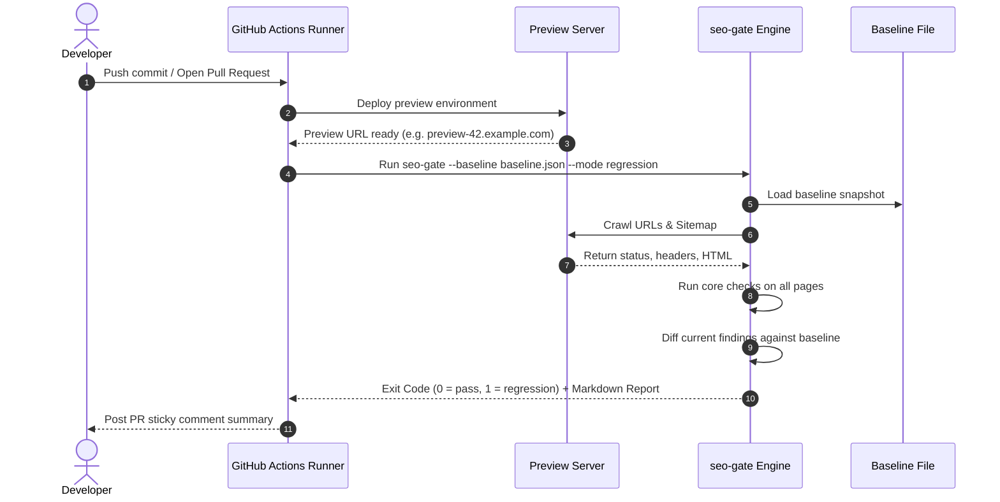
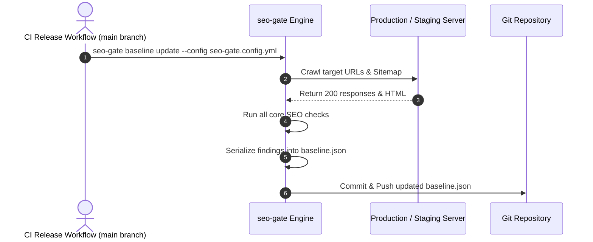
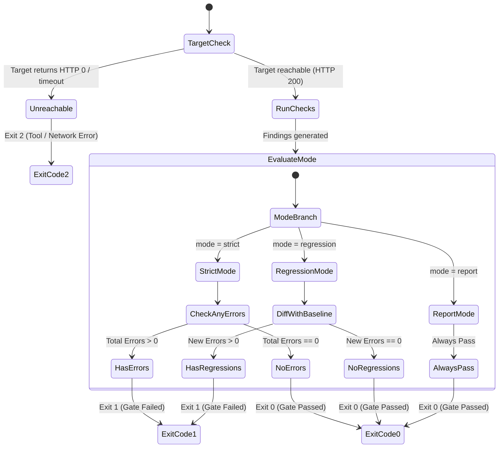

# System Design: Sequence & State Diagrams

## 1. In one paragraph
This document details the step-by-step execution flows of `seo-gate` across pull requests, baseline generation, and CI gate decision transitions using formal Mermaid sequence and state diagrams.

## 2. Why this exists
Visual sequence diagrams clarify the asynchronous ordering of operations between developers, GitHub CI/CD, the preview environment, the crawler, the check pipeline, and the diff engine. Understanding the exact message passing prevents architectural drift and ensures all engineers on the team share a mental model of how data moves through the system.

## 3. How it works

### Diagram 1: Pull Request Opened to Gate Determination

*How to read this diagram: The CI environment deploys the preview server, invokes seo-gate with the saved baseline, executes the crawl, runs the diff engine, and delivers findings back to the PR.*

---

### Diagram 2: Baseline Update Workflow

*How to read this diagram: After merging to main, the release workflow generates a fresh baseline snapshot and commits it back to the repository.*

---

### Diagram 3: Gate Mode Decision State Diagram

*How to read this diagram: The state machine checks target reachability first. If reachable, it evaluates findings according to the active gate mode before transitioning to exit code 0, 1, or 2.*

## 4. Example
A practical timeline during a GitHub Actions run:
- **T+0s:** PR #14 opened.
- **T+15s:** Ephemeral preview deployed at `https://preview-14.example.com`.
- **T+18s:** `seo-gate` initiates crawl; fetches 10 pages in 1.4s.
- **T+20s:** Diff engine identifies 0 new errors, 1 pre-existing warning from baseline.
- **T+21s:** `seo-gate` exits with code `0`, PR check turns green.

## 5. Salesforce analogy
In Salesforce terms:
- The PR sequence diagram is like a **GitHub Actions CI workflow running `sf project deploy validate` against a Scratch Org**.
- The Baseline Update sequence is like taking a **Production Sandbox Metadata Backup** after a major release.
- The State Diagram is like the decision logic inside an **Apex Trigger Handler** deciding whether to call `record.addError()` and abort the transaction or allow the DML to commit.

## 6. Common mistakes and What to remember
- **Mistake:** Attempting to diff against a missing baseline file without fallback handling. (If baseline is missing in `regression` mode, the engine treats all errors as potential regressions).
- **Mistake:** Treating network unreachable errors as exit code 0 or exit code 1. (Unreachable targets must always yield exit code 2).
- **Remember:** State transitions are deterministic; identical page audits and baselines always produce identical exit codes.
