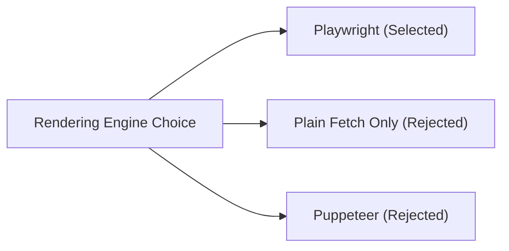
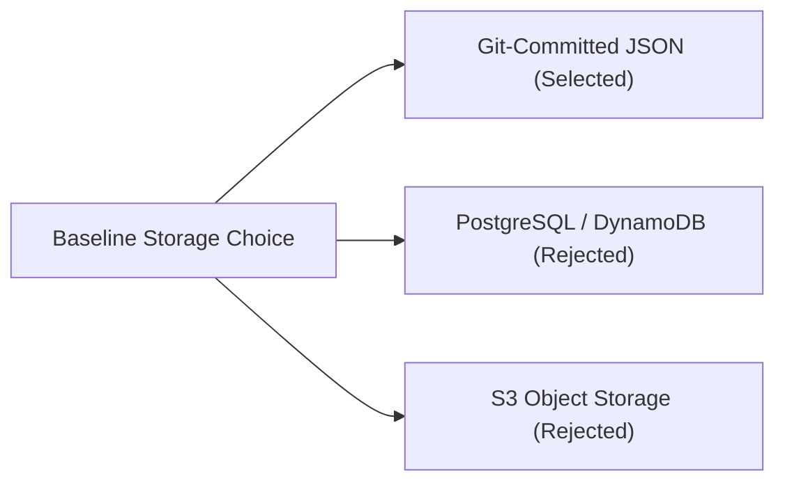

# System Design: Architectural Trade-Offs

## 1. In one paragraph
Every engineering decision involves trade-offs between speed, accuracy, complexity, and operational cost. This document details the key technical trade-offs made in `seo-gate`, explaining what choices were selected, what alternatives were rejected, and the rationale behind each decision.

## 2. Why this exists
Architecture is defined by constraints. When interviewers or stakeholders ask, *"Why didn't you use Puppeteer?"* or *"Why store baselines in Git instead of PostgreSQL?"*, this document provides the exact technical and operational rationale.

## 3. The Trade-Off Matrix

### Trade-Off 1: Playwright vs. Plain Fetch vs. Puppeteer



- **Selected: Playwright (Chromium)**
  - *Pros:* Modern API, excellent cross-platform support (Windows/Linux/macOS), reliable network interception (`page.route()`), built-in browser installation commands, and seamless remote debugging port integration for Lighthouse.
  - *Cons:* Heavier binary footprint (~150MB download in CI), higher memory usage than raw HTTP requests.
- **Alternative 1: Plain Fetch + Cheerio Only**
  - *Why rejected:* Cannot detect client-rendered single-page applications (Salesforce Experience Cloud, React, Vue). Would produce false negatives on dynamic storefronts.
- **Alternative 2: Puppeteer**
  - *Why rejected:* Less consistent multi-browser support, historically more prone to zombie Chrome processes on CI runner disconnects.

---

### Trade-Off 2: Git-Committed Baseline Files vs. External Database



- **Selected: Git-Committed JSON (`baseline.json`)**
  - *Pros:* Zero external infrastructure costs; zero secrets or connection strings needed in CI; baselines are strictly version-controlled alongside the application code; pull request branches can update baselines transparently via git commits.
  - *Cons:* Repo size grows slightly over years (mitigated by storing only findings and numeric metrics, not entire HTML bodies).
- **Alternative: Hosted Database (PostgreSQL / DynamoDB)**
  - *Why rejected:* Requires database credentials in CI secrets (violating Rule 5 minimization), network access rules, database migration overhead, and monthly hosting costs.

---

### Trade-Off 3: Median-of-3 Lighthouse Runs vs. Single Run

- **Selected: Median of 3 Runs with Flaky Confirmation**
  - *Pros:* Eliminates transient CI runner CPU throttling spikes; reduces false-positive build failures to near zero.
  - *Cons:* Multiplies Lighthouse audit duration by $3\times$ (mitigated by restricting Lighthouse to 2–5 critical pages).
- **Alternative: Single Run**
  - *Why rejected:* Single Lighthouse runs on virtualized CI runners exhibit variance of $\pm 25\%$, which leads to build breakage and causes developers to disable the tool.

---

### Trade-Off 4: Regression Mode vs. Strict Mode

- **Selected: Regression Mode as Recommended Default**
  - *Pros:* Prevents legacy technical debt from blocking urgent feature delivery; only fails pull requests on newly introduced errors; enables incremental adoption.
  - *Cons:* Existing issues remain until intentionally prioritized.
- **Alternative: Strict Mode Only**
  - *Why rejected:* Running strict mode on legacy enterprise storefronts produces hundreds of failures on day one, causing teams to abandon the tool.

## 4. Example
Comparison of baseline storage approaches:
```
Approach: Git-Committed baseline.json
Infrastructure Cost: $0.00
CI Credentials Required: 0
Sync Mechanism: git merge / PR approval
Rollback Mechanism: git revert

Approach: Hosted PostgreSQL
Infrastructure Cost: $15–$50 / month
CI Credentials Required: DATABASE_URL, VPC peering / allowlist
Sync Mechanism: External DB migrations
Rollback Mechanism: Manual snapshot restore
```

## 5. Salesforce analogy
Choosing **Git-Committed baselines** over external databases is like using **Salesforce Custom Metadata Types** instead of external web service endpoints. Custom Metadata is stored directly with the metadata repository, deploys via Git, has zero runtime hosting cost, and requires no API keys or endpoint allowlists.

## 6. Common mistakes and What to remember
- **Mistake:** Assuming that more features and more complex infrastructure equal better architecture. Boring, self-contained architecture (Git baselines, single-file HTML reports, pure functions) produces dramatically higher reliability in enterprise CI.
- **What to remember:** Always evaluate architectural choices against operational burden. If a tool requires external servers to run in CI, adoption drops.
