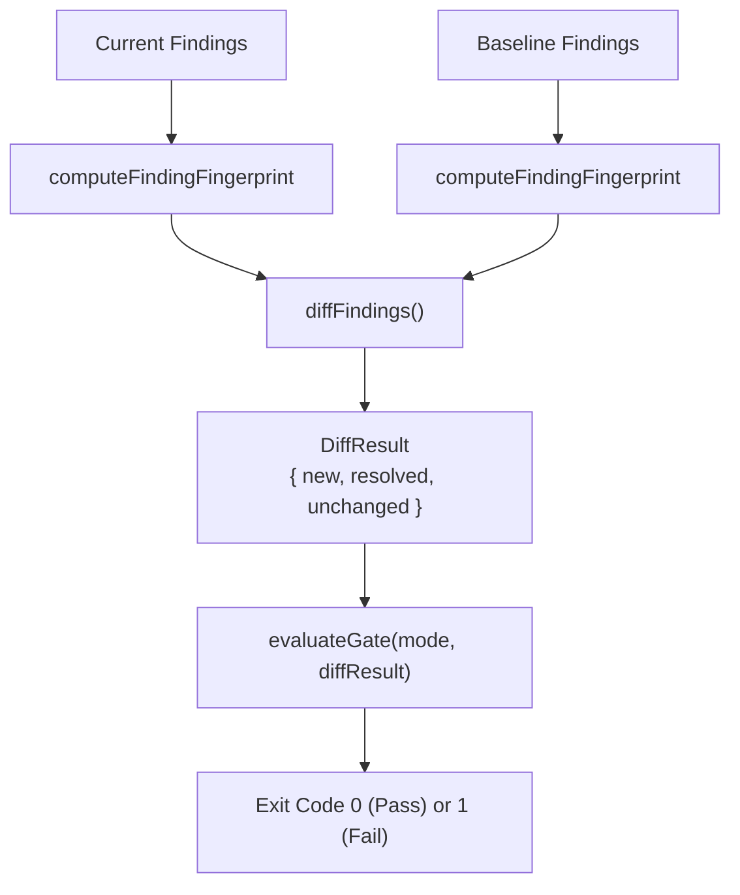

# Code Walkthrough: Baseline & Diff Engine

## 1. In one paragraph
This document walks through the implementation of `src/baseline/`, explaining how baseline snapshots are written, how current findings are fingerprinted and partitioned against baselines, and how exit codes are determined across gate modes.

## 2. Why this exists
Developers reviewing this project—or explaining it in an engineering interview—need to know the precise execution order and function calls responsible for regression testing. Walking through concrete inputs and function traces demystifies how `seo-gate` differentiates between legacy technical debt and brand-new regressions.

## 3. How it works

### Core Functions in Order of Execution
1. `loadBaseline(baselinePath: string): BaselineSnapshot`: Reads and validates `baseline.json` from disk.
2. `computeFindingFingerprint(finding: Finding): string`: Generates `${checkId}::${normalizedPath}`.
3. `diffFindings(current: Finding[], baseline: Finding[]): DiffResult`: Partitions findings into `newFindings`, `resolvedFindings`, and `unchangedFindings`.
4. `evaluateGate(mode: GateMode, diffResult: DiffResult, totalErrors: number): boolean`: Evaluates whether the run passes or fails the gate.
5. `writeBaseline(snapshot: BaselineSnapshot, outputPath: string): void`: Serializes a new baseline snapshot to disk during `seo-gate baseline update`.


*How to read this diagram: Findings are fingerprinted, passed into diffFindings, and evaluated by evaluateGate according to active gate mode.*

## 4. Example
A code execution trace:

### Step 1: Baseline Input (`baseline.json`)
```json
{
  "schemaVersion": 1,
  "findings": [
    {
      "checkId": "meta-description-short",
      "url": "https://www.example.com/about",
      "severity": "warn"
    }
  ]
}
```

### Step 2: Current Preview Run Input
```json
[
  {
    "checkId": "meta-description-short",
    "url": "https://preview-99.example.com/about",
    "severity": "warn"
  },
  {
    "checkId": "noindex-meta",
    "url": "https://preview-99.example.com/shoes",
    "severity": "error"
  }
]
```

### Step 3: `diffFindings()` Output
```typescript
{
  newFindings: [
    { checkId: "noindex-meta", url: "https://preview-99.example.com/shoes", severity: "error" }
  ],
  resolvedFindings: [],
  unchangedFindings: [
    { checkId: "meta-description-short", url: "https://preview-99.example.com/about", severity: "warn" }
  ]
}
```

### Step 4: `evaluateGate('regression', diffResult)` Result
Because `newFindings` contains 1 finding with severity `'error'`, `evaluateGate` returns `false`, causing the CLI to exit with code `1`.

## 5. Salesforce analogy
In Salesforce terms:
- `loadBaseline()` is like querying a **Prior State Custom Object or Custom Metadata table**.
- `computeFindingFingerprint()` is like generating a **Unique External Key formula (`UPPER(Check_Name__c) + '_' + Path__c`)**.
- `diffFindings()` is like comparing **`Trigger.new` vs `Trigger.oldMap`** inside an Apex trigger to identify exactly which fields changed value.
- `evaluateGate()` is like deciding whether to fire **`record.addError()`**.

## 6. Common mistakes and What to remember
- **Mistake:** Assuming that resolving a warning counts as a failure. (Resolutions are positive improvements and never fail a gate).
- **Remember:** In `regression` mode, pre-existing errors in `unchangedFindings` do not fail the build.
