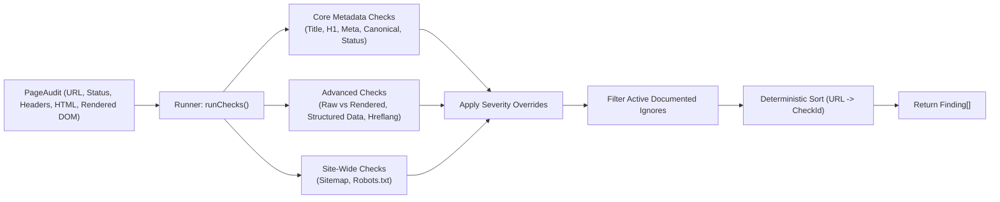

# Code Walkthrough: Checks Pipeline & Rules Engine

## 1. In one paragraph
This document walks through the `src/checks/` rules engine, detailing the execution of each SEO check function, how raw and rendered DOMs are compared, how structured data and hreflang tags are validated, and how findings are aggregated and tested.

## 2. Why this exists
To understand how `seo-gate` evaluates web pages—or to explain the architecture during an engineering interview—developers need a clear reference showing how check functions accept pure data models, evaluate deterministic conditions without side-effects, and emit structured `Finding` objects.

## 3. How it works

### The Check Suite Architecture
All checks implement the pure function signature:
```typescript
type CheckFunction = (page: PageAudit, context: CheckContext) => Finding[];
```

### Complete Check Suite Directory

| Check ID | Implementation File | What It Validates | Severity |
|---|---|---|---|
| `http-status` | `src/checks/http-status.ts` | 200 OK, 4xx client errors, 5xx server errors, redirect chains, loops. | Error / Warn |
| `title` | `src/checks/title.ts` | `<title>` presence, non-emptiness, length (20-65 chars), uniqueness across page set. | Error / Warn |
| `meta-description` | `src/checks/meta-description.ts` | Presence, length (70-160 chars), uniqueness across page set. | Warn |
| `h1` | `src/checks/h1.ts` | Exactly one non-empty `<h1>` per page. | Error / Warn |
| `canonical` | `src/checks/canonical.ts` | Presence, absolute URL syntax, self-referencing consistency, non-broken target. | Error / Warn |
| `noindex` | `src/checks/noindex.ts` | Accidental `noindex` in `<meta name="robots">` or `X-Robots-Tag` headers. | Error |
| `rendered-vs-raw` | `src/checks/rendered-vs-raw.ts` | Compares raw Cheerio HTML vs Playwright rendered DOM; flags JS-only content. | Error / Warn |
| `structured-data` | `src/checks/structured-data.ts` | Parses JSON-LD; validates schema.org required fields for Product, Breadcrumb, etc. | Error / Warn |
| `hreflang` | `src/checks/hreflang.ts` | Validates reciprocal hreflang links, ISO language codes, and self-references. | Error / Warn |
| `sitemap` | `src/checks/sitemap.ts` | Sitemap URL health (200 OK), canonical indexability, and URL count drops. | Error / Warn |
| `robots-txt` | `src/checks/robots-txt.ts` | Parses `robots.txt`, detects `Disallow: /`, and flags newly disallowed paths. | Error |


*How to read this diagram: PageAudit input flows into check evaluators. Findings are unified, filtered against documented ignore rules, and sorted deterministically.*

## 4. Example
A trace through `src/checks/rendered-vs-raw.ts`:
1. **Input:** `PageAudit` with `html` (raw string from server) and `renderedHtml` (DOM serialized by Playwright after client JS runs).
2. **Execution:**
   - Raw Cheerio parser evaluates `$('h1').length === 0`.
   - Rendered Cheerio parser evaluates `$('h1').length === 1` (`<h1>Client Rendered Product</h1>`).
3. **Output Finding:**
   ```json
   {
     "checkId": "rendered-vs-raw-critical",
     "url": "https://preview.example.com/shoes",
     "severity": "error",
     "message": "Critical element 'h1' only exists after JavaScript rendering",
     "evidence": "Raw: missing | Rendered: <h1>Client Rendered Product</h1>",
     "fixHint": "Ensure critical H1 headings are rendered server-side (SSR) so crawlers without JavaScript execution can index them.",
     "docsLink": "https://developers.google.com/search/docs/crawling-indexing/javascript/javascript-seo-basics"
   }
   ```

## 5. Salesforce analogy
In Salesforce development:
- The check suite is like a **Set of Apex Trigger Handlers and Validation Rules** executing against an `SObject` list.
- Each handler validates a distinct business invariant (e.g. `checkAccountBillingAddress()`, `checkDuplicateTaxId()`).
- The checks never execute external callouts or perform DML themselves; they solely evaluate data in memory and record errors.

## 6. Common mistakes and What to remember
- **Mistake:** Permitting checks to make external network requests.
- **Mistake:** Forgetting to update unit tests when adding new checks.
- **Remember:** Checks are pure functions; given the same input, they always produce identical findings.
