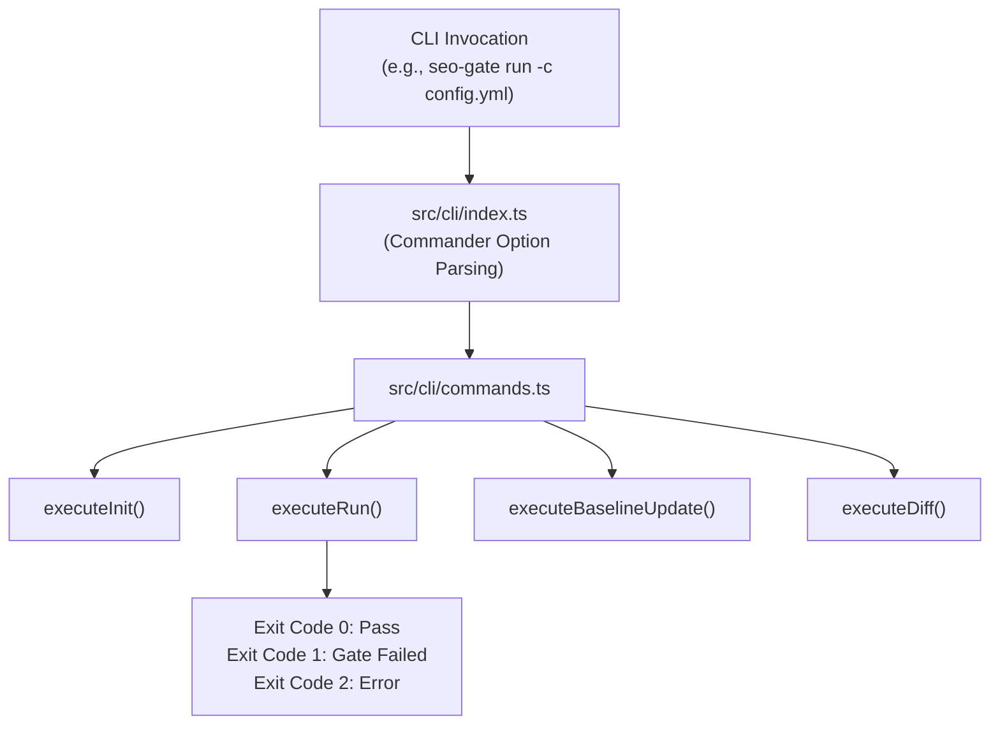

# Code Walkthrough: CLI & Command Orchestration

## 1. In one paragraph
The CLI module (`src/cli/index.ts` and `src/cli/commands.ts`) is the user-facing entry point for `seo-gate`, translating terminal commands and flags into coordinated pipeline runs, baseline updates, diff comparisons, and deterministic operating system exit codes.

## 2. Why this exists
Developers and CI pipelines interact with `seo-gate` exclusively through the command line. A reliable CLI must provide intuitive subcommands (`init`, `run`, `baseline update`, `diff`), enforce strict exit code contracts (`0` for pass, `1` for gate failed, `2` for errors), and present beautifully styled terminal summaries using Picocolors.

## 3. How it works
`src/cli/index.ts` configures Commander.js and delegates execution to `src/cli/commands.ts`:


*How to read this diagram: The CLI parses input flags, executes the requested command action, coordinates sub-modules, and maps results to exit codes.*

### The Subcommands
1. **`executeInit(targetUrl?: string)`:**
   - Checks if `seo-gate.config.yml` already exists to prevent accidental overwrites.
   - Writes a starter configuration pre-populated with safe defaults and returns exit code `0`.
2. **`executeRun(options: RunCommandOptions)`:**
   - Loads configuration via `loadConfig()`.
   - Optionally loads baseline snapshot via `loadBaseline()`.
   - Executes crawler via `crawlTarget()`.
   - Executes check suite via `runChecks()`.
   - Optionally triggers Lighthouse audits via `auditPagePerformance()`.
   - Performs differential evaluation via `diffFindings()` and `evaluateGate()`.
   - Generates JSON, Markdown, and HTML reports.
   - Syncs sticky PR comments and dispatches webhooks.
   - Returns exit code: `0` (clean/passed), `1` (gate failed), `2` (unreachable target or config error).
3. **`executeBaselineUpdate(options: BaselineUpdateOptions)`:**
   - Crawls target or production environment.
   - Runs check suite and generates a fresh snapshot.
   - Writes `baseline.json` and returns exit code `0`.
4. **`executeDiff(fileAPath: string, fileBPath: string)`:**
   - Reads two JSON result files from disk.
   - Computes differential findings and prints a terminal summary table.
   - Returns `1` if new regressions exist, `0` if clean.

## 4. Example
A typical run execution trace:
```bash
$ pnpm seo-gate run --config seo-gate.config.yml --mode regression --baseline baseline.json

🔍 seo-gate: Initializing run with config: seo-gate.config.yml...
   Target: https://preview-123.example.com [Mode: regression]
   Loading baseline snapshot: baseline.json...
   ✓ Loaded baseline with 4 prior finding(s)
   Crawling target pages and verifying reachability...
   ✓ Successfully fetched 12 page(s)
   Executing core SEO checks...
   ✓ Wrote JSON report to seo-gate-report.json

═══════════════════════════════════════════════════
                   RUN SUMMARY                     
═══════════════════════════════════════════════════
 Target:      https://preview-123.example.com
 Mode:        regression
 Audited:     12 page(s)
 Regressions: 1
 Resolved:    0
 Total Errors:1
 Warnings:    2
 Duration:    1.42s
═══════════════════════════════════════════════════

Top Regressions:
  ✗ [REGRESSION] noindex-meta on https://preview-123.example.com/products/shoes
    Page contains a noindex directive in HTML meta tag but is configured to be indexable
    Fix hint: Remove "noindex" from the <meta name="robots"> tag before deploying to production.

❌ Gate Failed: SEO regressions detected.
```

## 5. Salesforce analogy
The CLI commands correspond to **Salesforce CLI (`sf` / `sfdx`) project operations**:
- `seo-gate init` = `sf project generate`
- `seo-gate run` = `sf project deploy start --dry-run --test-level RunSpecifiedTests`
- `seo-gate baseline update` = `sf project retrieve start` (capturing org metadata state)
- `seo-gate diff` = `sf project deploy validate` (diffing change set vs org)

## 6. Common mistakes and What to remember
- **Mistake:** Exiting `0` when the target website is completely unreachable. In `seo-gate`, an unreachable target is treated as a fatal crawl failure and exits with code `2`.
- **Mistake:** Hardcoding file paths. Always resolve paths relative to `process.cwd()`.
- **What to remember:** Exit codes matter! CI systems depend on exit codes to pass or block builds.
