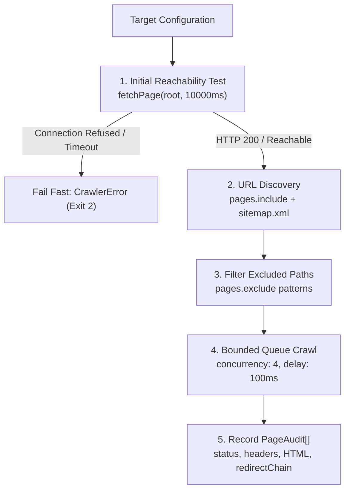

# Code Walkthrough: Crawler & Polite Fetcher

## 1. In one paragraph
The crawler module (`src/crawl/fetcher.ts` and `src/crawl/sitemap.ts`) discovers and fetches target web pages, records redirect chains and response headers, normalizes URLs, throttles concurrency to avoid overloading preview servers, and prepares clean `PageAudit` payloads for subsequent check inspection.

## 2. Why this exists
Without a controlled, polite crawler, testing a web storefront would either overwhelm staging infrastructure with thousands of simultaneous requests or fail to discover newly added product paths. `seo-gate` provides polite, bounded crawling with configurable concurrency limits (default: 4), request delays (default: 100ms), and automated redirect loop detection.

## 3. How it works
The crawling process proceeds in five sequential phases:


*How to read this diagram: An initial reachability probe validates the preview URL before URL discovery, path filtering, and concurrency-bounded crawling execute.*

### Key Functions
- **`normalizeUrl(rawUrl, baseUrl)`:** Normalizes protocol, strips default ports (80/443), removes trailing slashes (except root `/`), and strips hash fragments.
- **`fetchPage(url, timeoutMs, maxHops)`:** Fetches a single URL using native `fetch()`. Automatically records every hop in the redirect chain (`url`, `statusCode`) and detects redirect loops (>6 hops).
- **`crawlTarget(config)`:** The main orchestrator. First performs a reachability check on the root target URL. If unreachable, throws a descriptive `CrawlerError`. Gathers URLs from `pages.include` and `pages.sitemap`, filters out `pages.exclude`, and drains the queue using bounded concurrency workers.
- **`fetchSitemap(sitemapUrl)`:** Fetches and parses XML sitemaps, extracting `<loc>` tags from standard sitemaps and sitemap index files.

## 4. Example
Tracing a redirect chain captured by `fetchPage`:
```typescript
const pageAudit = await fetchPage('https://example.com/old-blog', 10000);

console.log(pageAudit.statusCode);     // 200
console.log(pageAudit.url);            // 'https://example.com/new-blog'
console.log(pageAudit.redirectChain);
// [
//   { url: 'https://example.com/old-blog', statusCode: 301 },
//   { url: 'https://example.com/new-blog', statusCode: 200 }
// ]
```

## 5. Salesforce analogy
The polite crawler is like a **Salesforce Batch Apex or Queueable job with Governor Limit Throttling**. In Salesforce, you throttle callouts to respect external system rate limits and avoid `LimitException: System.CalloutException`. Similarly, `seo-gate` limits concurrency to 4 and adds polite delays to respect staging server resource constraints.

## 6. Common mistakes and What to remember
- **Mistake:** Crawling arbitrary external domains. `crawlTarget()` strictly bounds URLs to the configured target domain or paths.
- **Mistake:** Following endless redirect loops until memory exhausts. `fetchPage()` caps redirect hops at 6 and records every step in `redirectChain`.
- **What to remember:** An unreachable preview URL must fail fast. Testing an unreachable site and reporting zero findings as a "Pass" is dangerous in CI.
