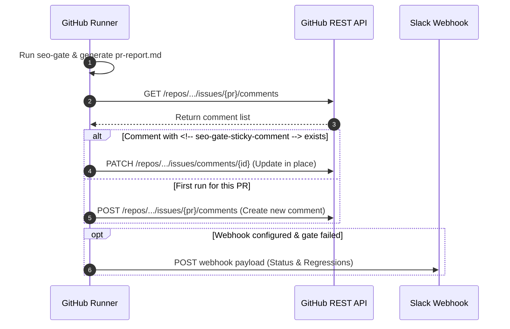

# Code Walkthrough: GitHub Action & Sticky PR Comments

## 1. In one paragraph
This document walks through the GitHub Actions integration, explaining how the composite action (`action.yml`) runs in CI workflows, how the sticky comment manager updates a single PR comment per pull request using marker tags, and how webhooks deliver alerts to Slack and Microsoft Teams.

## 2. Why this exists
In CI/CD environments, automated bot comments often create chaos: if a bot posts a new comment on every push to a branch, a 15-commit pull request ends up with 15 duplicate comments, drowning out real human discussion. The sticky comment manager searches for an existing `seo-gate` comment using a hidden HTML identifier and updates it in place, keeping the pull request clean and readable for both developers and SEO specialists.

## 3. How it works
The GitHub Action integration operates in four steps:
1. **Workflow Execution:** GitHub Actions executes `action.yml`, which installs dependencies and runs `seo-gate run` against the deployed preview environment.
2. **Report Generation:** `seo-gate` generates structured JSON and Markdown summary reports.
3. **Sticky PR Comment Resolution:**
   - The comment engine queries GitHub's REST API: `GET /repos/{owner}/{repo}/issues/{issue_number}/comments`.
   - It searches for the hidden marker: `<!-- seo-gate-sticky-comment -->`.
   - If an existing comment is found, it issues `PATCH /repos/{owner}/{repo}/issues/comments/{comment_id}`.
   - If no comment exists yet, it issues `POST /repos/{owner}/{repo}/issues/{issue_number}/comments`.
4. **Webhook Dispatch:** If Slack or Teams webhooks are configured in `seo-gate.config.yml` or environment variables, a concise alert card is dispatched.


*How to read this diagram: The workflow checks for existing comments with the hidden identifier. If found, it updates the existing comment in place instead of creating a duplicate.*

## 4. Example
The sticky comment payload stored in the GitHub PR:
```markdown
<!-- seo-gate-sticky-comment -->
## 🔴 seo-gate: Gate Failed

Automated SEO regression audit for **https://preview-123.example.com** (Mode: `regression`).

| Metric | Value |
|---|---|
| **Target URL** | `https://preview-123.example.com` |
| **New Regressions** | 🚨 **1** |
| **Total Errors** | ❌ 1 |
| **Resolved Issues** | 🎉 0 |

### 🚨 New Regressions Requiring Attention
| Check | URL | Message | Fix Hint |
|---|---|---|---|
| `noindex-meta` | https://preview-123.example.com/shoes | Accidental noindex tag | Remove noindex tag |
```

## 5. Salesforce analogy
In Salesforce development:
- A sticky PR comment is like updating an existing **FeedItem record on a Chatter post or Case feed** using `ConnectApi.ChatterFeeds.updateFeedElement()` rather than creating 15 new duplicate posts every time an integration runs.
- Webhook dispatch is like an **Outbound Message or Apex Callout** firing to Slack when an Opportunity stage changes to `Closed Lost`.

## 6. Common mistakes and What to remember
- **Mistake:** Leaking GitHub personal access tokens or webhook URLs in command-line arguments or log traces. (Always pass credentials via environment variables: `GITHUB_TOKEN`, `SLACK_WEBHOOK_URL`).
- **Mistake:** Posting duplicate comments on every push to a branch.
- **Remember:** The hidden HTML tag `<!-- seo-gate-sticky-comment -->` is what makes the comment sticky.
