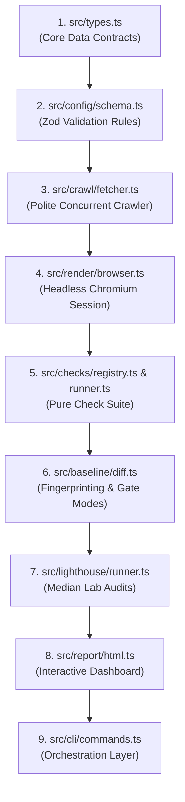

# Code Walkthrough: Suggested Reading Order

## 1. In one paragraph
This guide provides the exact sequence in which to read the `seo-gate` codebase, starting from the core type contracts and progressing through the configuration parser, crawler queue, pure check functions, diffing engine, and reporting modules.

## 2. Why this exists
Jumping randomly into a new codebase creates cognitive overload. When reviewing `seo-gate`—or preparing to explain it in a technical interview—following a structured reading path makes the unidirectional architecture and clean separation of concerns immediately obvious.

## 3. How it works
The recommended reading order follows the data flow of an execution run:

*How to read this diagram: Read contracts first, then input validation, crawling, rendering, checks, diffing, lab performance, reports, and finally CLI orchestration.*

### Detailed Reading Sequence

1. **[src/types.ts](file:///d:/seo-gate/src/types.ts)**
   - *First file to open.*
   - *What to look for:* The foundational TypeScript contracts (`Finding`, `PageAudit`, `SeoGateConfig`, `RunResult`, `PagePerformanceAudit`). Notice that findings carry evidence and fix hints, and `schemaVersion: 1` ensures version stability.
2. **[src/config/schema.ts](file:///d:/seo-gate/src/config/schema.ts)**
   - *What to look for:* How Zod validates user configuration at launch. Every invalid field produces human-friendly error messages before any network request occurs.
3. **[src/crawl/fetcher.ts](file:///d:/seo-gate/src/crawl/fetcher.ts)**
   - *What to look for:* Concurrency throttling (default: 4), polite delay timers, URL normalization, redirect chain recording, and the initial reachability test on target root.
4. **[src/render/browser.ts](file:///d:/seo-gate/src/render/browser.ts)**
   - *What to look for:* Playwright headless Chromium lifecycle. Look at `page.route()` aborting image, font, and stylesheet requests to optimize CI execution speed.
5. **[src/checks/registry.ts](file:///d:/seo-gate/src/checks/registry.ts) & individual checks in `src/checks/`**
   - *What to look for:* How every check is a pure function that never performs I/O. Look at `rendered-vs-raw.ts` to see how hydration gaps are caught, and `structured-data.ts` to see JSON-LD schema assertions.
6. **[src/baseline/diff.ts](file:///d:/seo-gate/src/baseline/diff.ts)**
   - *What to look for:* Finding fingerprinting (`${checkId}::${pathname}` from ADR-0002) stripping ephemeral hostnames, three-way partitioning (`newFindings`, `resolvedFindings`, `unchangedFindings`), and `evaluateGate()` logic.
7. **[src/lighthouse/runner.ts](file:///d:/seo-gate/src/lighthouse/runner.ts)**
   - *What to look for:* Connecting to Chromium CDP via `--remote-debugging-port`, `computeMedian` calculating medians across 3 runs, and two-strike confirmation re-runs for flaky protection.
8. **[src/report/html.ts](file:///d:/seo-gate/src/report/html.ts)**
   - *What to look for:* Single-file HTML generation with zero external CDN dependencies, embedded CSS, and client-side vanilla JavaScript filtering.
9. **[src/cli/commands.ts](file:///d:/seo-gate/src/cli/commands.ts)**
   - *What to look for:* The top-level orchestrator wiring crawler, checks, baseline diffing, performance lab audits, reports, and deterministic exit codes (`0`, `1`, `2`).

## 4. Example
If asked during an interview: *"How does a finding flow from raw HTTP response to a pull request comment?"*
Trace this exact order:
1. `fetchPage` in `src/crawl/fetcher.ts` fetches HTML and records headers.
2. `renderPage` in `src/render/browser.ts` optionally captures hydrated DOM.
3. `runChecks` in `src/checks/runner.ts` executes pure checks and returns `Finding[]`.
4. `diffFindings` in `src/baseline/diff.ts` marks new vs. pre-existing findings.
5. `generateMarkdownReport` in `src/report/markdown.ts` builds the PR comment body.
6. `postOrUpdateStickyComment` in `src/github/comment.ts` creates or patches the PR comment.

## 5. Salesforce analogy
Reading the codebase in this order is like reviewing a Salesforce application:
- `src/types.ts` = **SObject Schema definitions & Custom Fields**
- `src/config/schema.ts` = **Custom Metadata Types & Validation Rules**
- `src/crawl/fetcher.ts` = **Queueable / Batch Apex Callouts**
- `src/checks/` = **Before-Insert Trigger logic & Unit Test Assertions**
- `src/baseline/diff.ts` = **Scratch Org / Sandbox Org Deployment Diff Tool**
- `src/report/` = **Lightning Report & Dashboard Builder**

## 6. Common mistakes and What to remember
- **Mistake:** Trying to understand the CLI commands before understanding the pure data contracts in `src/types.ts`.
- **What to remember:** Dependencies point strictly one way: `cli` $\rightarrow$ (`config`, `crawl`, `render`, `checks`, `lighthouse`, `baseline`, `report`, `github`). No module ever imports `cli`.
