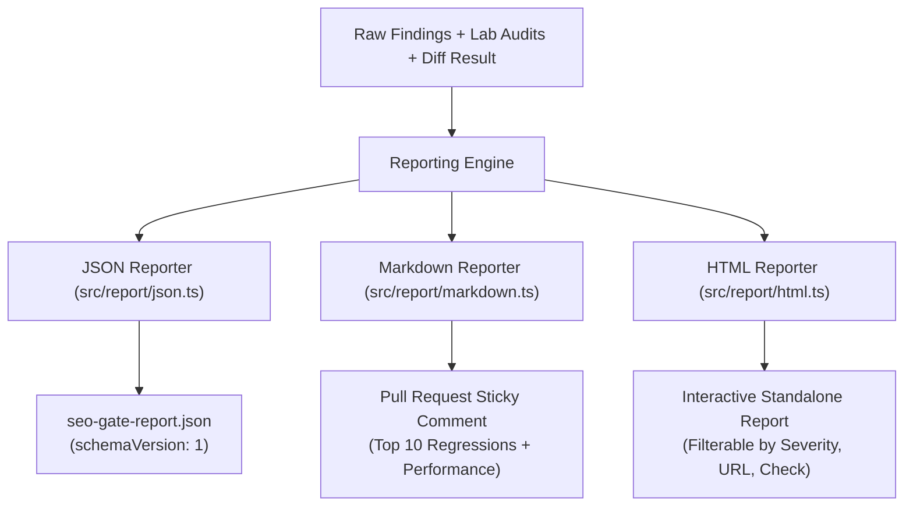

# Code Walkthrough: Reports Engine (JSON, Markdown & Interactive HTML)

## 1. In one paragraph
The reporting layer transforms raw SEO check findings and Lighthouse lab performance metrics into clean, human-readable outputs across three distinct formats: machine-parsable JSON for CI/CD scripting, a concise Markdown summary for pull request comments, and an interactive, standalone HTML report for visual inspection by developers and SEO specialists.

## 2. Why this exists
Raw log dumps in CI/CD pipelines are difficult for developers and non-technical SEO specialists to parse. If an engineer cannot quickly determine which exact `<meta>` tag broke or how to fix it, adoption fails. The reporting engine ensures that every finding includes human-friendly context: the exact evidence extracted from the DOM, a clear fix hint, and structured baseline comparison deltas.

## 3. How it works
The reporting engine consists of three pure formatter modules under `src/report/`:


*How to read this diagram: Audited data feeds into three decoupled formatters, producing machine data (JSON), PR feedback (Markdown), and an interactive dashboard (HTML).*

### The Three Formats
1. **JSON (`src/report/json.ts`):** Produces a strictly typed, versioned document (`schemaVersion: 1`) containing summary metrics, full findings arrays, and lab performance audits. Designed for programmatic consumption, datadog pipelines, or artifact archiving.
2. **Markdown (`src/report/markdown.ts`):** Generates a GitHub-flavored Markdown document formatted for pull request comments. Prioritizes new regressions with tables, celebrates resolved debt, collapses pre-existing baseline debt into `<details>` accordions, and links to the full HTML report.
3. **Interactive HTML (`src/report/html.ts`):** Generates a completely self-contained, single-file HTML dashboard with embedded CSS and vanilla JavaScript. Features live text search, severity filter buttons (All, Errors, Warnings), URL dropdown filtering, and responsive KPI cards. Requires zero external CDNs, making it safe for air-gapped CI environments.

## 4. Example
A snippet of the interactive HTML report generation:
```typescript
import { generateHtmlReport, writeHtmlReport } from './html.js';

const html = generateHtmlReport({
  target: 'https://preview-123.example.com',
  mode: 'regression',
  totalPages: 12,
  passed: false,
  findings: [
    {
      checkId: 'canonical-missing',
      url: 'https://preview-123.example.com/checkout',
      severity: 'error',
      message: 'Page is missing a canonical link tag',
      evidence: 'No <link rel="canonical"> element found in HTML head',
      fixHint: 'Add a self-referencing absolute canonical tag.',
    }
  ],
  durationSeconds: 3.2,
});

writeHtmlReport(html, 'artifacts/seo-gate-report.html');
```

## 5. Salesforce analogy
Think of the three report formats like Salesforce's reporting tiers:
- **JSON:** Like the **Salesforce REST API query result** (`/services/data/vXX.0/query?q=...`) for automated backend integrations.
- **Markdown:** Like a **Salesforce Chatter notification or Slack alert card** summarizing record changes for team visibility.
- **HTML:** Like a **Salesforce Lightning Dashboard or Visualforce Page**, giving business stakeholders an interactive, visual interface with filters, KPI tiles, and drill-down tables.

## 6. Common mistakes and What to remember
- **Mistake:** Depending on external CSS frameworks (like Tailwind or Bootstrap CDN) inside the HTML report. In enterprise CI runners or air-gapped VPNs, external CDN requests fail, resulting in unstyled HTML. Always embed CSS and JavaScript directly into the HTML payload.
- **Mistake:** Overloading PR comments with hundreds of pre-existing issues. Always collapse pre-existing technical debt into `<details>` blocks and display only new regressions at the top.
- **What to remember:** Every finding in every format must include evidence (the exact tag found) and an actionable fix hint. A report without fix hints frustrates developers.
