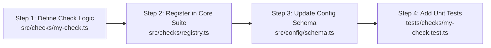

# Operations: How to Author and Add a New Check

## 1. In one paragraph
This step-by-step developer guide explains how to author, configure, test, and register a new SEO check in `seo-gate` following the project's pure-function architecture and 85% test coverage requirement.

## 2. Why this exists
As storefront requirements evolve—such as enforcing Open Graph social tags, validating AMP tags, or asserting specific microdata—developers need a predictable, standardized procedure for extending the check suite without introducing circular dependencies or side-effect bugs.

## 3. How it works
Authoring a new check follows four concrete steps:


*How to read this diagram: Create the pure check function, register it in the check array, expose its options in the Zod config schema, and write unit tests.*

### Detailed Steps

1. **Step 1: Create the Check File (`src/checks/<name>.ts`):**
   - Implement the `CheckDefinition` interface.
   - Use `cheerio` for HTML inspection or read headers from `page.headers`.
   - **Constraint:** Never perform `fetch()`, disk reads, or external API calls inside the check.
2. **Step 2: Register the Check in `src/checks/registry.ts`:**
   - Import your definition and append it to the `CORE_CHECKS` array.
3. **Step 3: Add Configuration Schema (`src/config/schema.ts`):**
   - Define a Zod schema for any tunable thresholds (e.g. min/max lengths, enabled flags).
   - Add it to `ChecksSchema` with sensible defaults.
4. **Step 4: Write Unit Tests (`tests/checks/<name>.test.ts`):**
   - Write positive tests (assert clean HTML produces 0 findings).
   - Write negative tests (assert malformed HTML produces exact findings with fix hints).
   - Maintain $\ge 85\%$ test coverage across `src/checks/`.

## 4. Example
Authoring a simple `open-graph-title` check:
```typescript
// src/checks/og-title.ts
import * as cheerio from 'cheerio';
import type { CheckDefinition, CheckContext } from './types.js';
import type { Finding, PageAudit } from '../types.js';

export const OgTitleCheck: CheckDefinition = {
  id: 'og-title',
  name: 'Open Graph Title Check',
  description: 'Asserts that og:title is present on indexable pages',
  run(page: PageAudit, context: CheckContext): Finding[] {
    if (!page.html) return [];
    const $ = cheerio.load(page.html);
    const ogTitle = $('meta[property="og:title"]').attr('content')?.trim();

    if (!ogTitle) {
      return [
        {
          checkId: 'og-title-missing',
          url: page.url,
          severity: 'warn',
          message: 'Page is missing an Open Graph title meta tag (og:title)',
          evidence: 'No <meta property="og:title"> element found',
          fixHint: 'Add a <meta property="og:title" content="..."> tag in HTML head for social media sharing previews.',
          docsLink: 'https://ogp.me/#metadata',
        },
      ];
    }
    return [];
  },
};
```

## 5. Salesforce analogy
Adding a check in `seo-gate` is like **adding a new Custom Validation Rule or Apex Trigger Handler** in Salesforce:
- `CheckDefinition.run` = **Validation Rule formula or `Trigger.isBefore` validation method**
- `Finding` = **`SObject.addError('Your message here')`**
- `src/checks/registry.ts` = **Trigger Handler Framework registration**

## 6. Common mistakes and What to remember
- **Mistake:** Performing network requests inside the check function. All network data must be gathered by the crawler upfront into `PageAudit`.
- **Mistake:** Forgetting to register the check in `src/checks/registry.ts`.
- **What to remember:** Always provide a concrete `evidence` snippet and an actionable `fixHint` on every finding you create.
