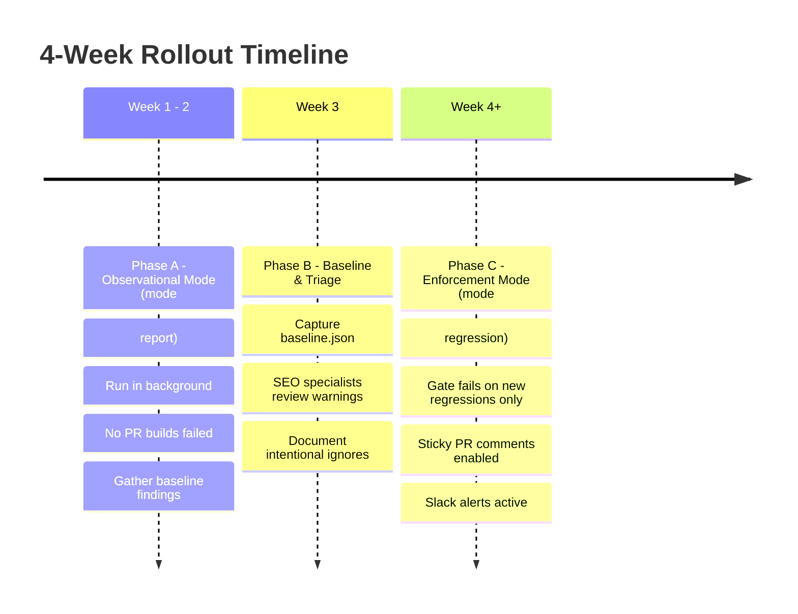

# Operations: How to Roll Out seo-gate to the Team

## 1. In one paragraph
This document outlines a phased, safe rollout plan for introducing `seo-gate` across 7 Salesforce developers, 3 full-stack engineers, and 3 SEO specialists, transitioning from observational reporting to automated blocking without disrupting sprint velocity.

## 2. Why this exists
Introducing a strict CI/CD quality gate abruptly to an active engineering team often leads to frustration, team friction, and bypassed checks if existing technical debt blocks normal feature releases. A phased rollout builds trust in the tool's accuracy, allows developers and SEO specialists to align on baseline rules, and establishes clear ownership before gates begin failing builds.

## 3. How it works

### The 3-Phase Team Rollout Plan

*How to read this diagram: The team begins with 2 weeks in report mode to observe findings, takes a baseline snapshot in Week 3, and enables regression gate enforcement in Week 4.*

### Phase A: Observational Mode (Weeks 1 to 2)
- Configure `mode: report` in `seo-gate.config.yml`.
- `seo-gate` runs on every pull request, but **never fails the build** (always exit code `0`).
- The team observes the generated Markdown reports in PR comments.
- Developers see real findings without facing delivery delays.

### Phase B: Baseline Snapshot & Triage (Week 3)
- Run `seo-gate baseline update` on the `main` branch to commit the initial `baseline.json`.
- SEO specialists review existing warnings (e.g. duplicate descriptions, legacy redirect chains).
- Any intentional legacy exceptions are added to the `ignore:` section with clear documented reasons.

### Phase C: Active Regression Enforcement (Week 4 onward)
- Switch configuration to `mode: regression`.
- Pull requests are blocked only if **new regressions** are introduced.
- Pre-existing baseline debt continues to be reported in collapsed accordions without blocking releases.
- Scheduled daily production audit workflow is activated to monitor content and CMS changes.

## 4. Example
Adoption Tracking Scorecard (recorded in team sprint retrospectives):
- **Week 1 (Report Mode):** 18 runs, 0 PRs blocked, 4 accidental `noindex` warnings identified by developers before merge.
- **Week 3 (Baseline):** Captured 12 baseline warnings across 45 storefront pages; 2 documented ignores added for `/legal/*`.
- **Week 4 (Regression Mode):** 24 runs, 2 PRs blocked due to accidental canonical deletion, both fixed by author in < 5 minutes.
- **False Positive Rate:** 0% false alerts.

## 5. Salesforce analogy
In Salesforce development, this is identical to **rolling out a new Apex Validation Rule or Trigger**:
- First, you deploy the validation rule in **Inactive** state (or with a custom setting bypass) to monitor existing record data.
- You identify existing records that violate the rule and either clean them up or document exceptions.
- Finally, you activate the validation rule for **new record inserts and updates only**, ensuring historical records do not block daily business operations.

## 6. Common mistakes and What to remember
- **Mistake:** Launching directly into `mode: strict` on Day 1. This causes developers to view the tool as a blocker rather than a safety net.
- **Mistake:** Failing to involve SEO specialists in the configuration review.
- **Remember:** Start in `mode: report` for 2 weeks, capture a clean baseline, then switch to `mode: regression`.
