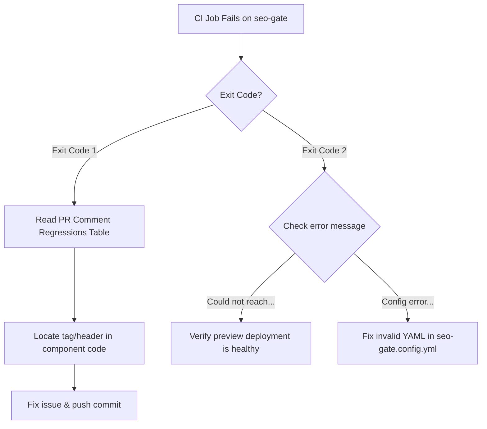

# Operations Runbook

## 1. In one paragraph
This runbook provides actionable, step-by-step procedures for developers and SEO specialists to execute `seo-gate` locally, update production baselines, troubleshoot CI build failures, and manage exceptions.

## 2. Why this exists
When an automated CI quality gate blocks a deployment or pull request, developers need an immediate, standardized guide on what the failure means, how to reproduce it on their local machine in under a minute, and how to safely remediate it without resorting to unapproved bypasses.

## 3. How it works

### Standard Operating Procedures (SOP)

#### SOP 1: Running `seo-gate` Locally Against a Preview or Local Server
```bash
# 1. Start your local application or storefront
pnpm dev # (e.g. running at http://localhost:3000)

# 2. Run seo-gate in report mode to inspect findings locally
pnpm seo-gate run --config seo-gate.config.yml --mode report
```

#### SOP 2: Updating the Baseline After Release
Whenever changes are merged to the `main` branch or released to production:
```bash
# 1. Ensure you have pulled latest main branch
git checkout main && git pull

# 2. Run baseline update against the production/staging site
pnpm seo-gate baseline update --config seo-gate.config.yml --output baseline.json

# 3. Commit and push the updated baseline
git add baseline.json
git commit -m "chore(seo): update baseline snapshot for v1.2 release"
git push origin main
```

#### SOP 3: Adding a Documented Exception (Ignore Rule)
If a page has an intentional or unavoidable reason for an SEO warning (e.g. legal pages requiring fixed statutory titles):
1. Open `seo-gate.config.yml`.
2. Add an entry under `ignore:` with a mandatory `reason` and optional `expires`:
   ```yaml
   ignore:
     - check: "title-length-short"
       url: "/legal/*"
       reason: "Legal terms require fixed statutory title"
       expires: "2027-12-31"
   ```
3. Commit the change with your PR. The report will list this ignore openly in the pull request comment.

### Exit Code Troubleshooting Table

| Exit Code | Meaning | Root Cause | Immediate Action |
|---|---|---|---|
| **`0`** | **Pass** | All checks clean, or no regressions vs baseline. | Build proceeds normally. |
| **`1`** | **Gate Failed** | New regression detected (e.g. accidental `noindex`, missing title). | Inspect the PR Markdown comment table; fix the tag or header. |
| **`2`** | **Tool / Config Error** | Target preview unreachable (timeout/connection failure), or invalid YAML. | Verify preview server is running and accessible from the CI runner. |


*How to read this diagram: Route troubleshooting based on exit code: Code 1 indicates an SEO defect in application code; Code 2 indicates preview infrastructure or config issues.*

## 4. Example
A developer's terminal debugging session:
```bash
$ pnpm seo-gate run --config seo-gate.config.yml --baseline baseline.json --mode regression
...
Top Regressions:
  ✗ [REGRESSION] noindex-meta on https://preview.store.com/category/shoes
    Page contains a noindex directive in HTML meta tag but is configured to be indexable
    Fix hint: Remove "noindex" from the <meta name="robots"> tag before deploying to production.
```
Remediation: Search the codebase for `robots` or `noindex` in the category template, remove the stray attribute, and re-commit.

## 5. Salesforce analogy
In Salesforce terms:
- Running locally is like running **Apex Unit Tests in VS Code (`SFDX: Run Apex Tests`)** before attempting to deploy.
- Updating `baseline.json` is like **refreshing a Sandbox metadata backup** after a major deployment.
- The ignore rule is like creating a **Custom Permission or Bypass Setting** with a Jira ticket reference in the description field.

## 6. Common mistakes and What to remember
- **Mistake:** Changing `mode: strict` to `mode: report` on a PR just to force a failing build to pass. (Fix the underlying SEO tag instead of disabling the gate).
- **Mistake:** Adding an ignore rule without an expiration date for temporary migration issues.
- **Remember:** Exit code `2` means your test didn't run because the preview wasn't ready; it is an infrastructure failure, not an SEO failure.
