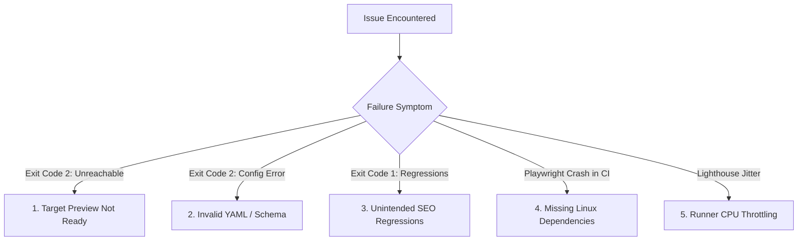

# Operations: Troubleshooting Guide

## 1. In one paragraph
This runbook provides actionable diagnoses and remediation steps for common operational issues encountered when running `seo-gate` in local development and CI/CD pipelines, including network timeouts, authentication challenges, browser startup failures, and unexpected gate failures.

## 2. Why this exists
When an automated quality gate fails a production deployment at midnight or blocks an urgent pull request, engineers need immediate, concrete solutions. This guide details symptom-cause-solution matrices to unblock developers quickly.

## 3. Symptom, Cause & Remediation Matrix


*How to read this diagram: Match the symptom to the decision node to locate the root cause and remediation procedure.*

### Common Operational Issues

#### 1. Target Unreachable (Exit Code 2)
- **Symptom:** `❌ Crawl Error: Could not reach https://... (timeout or connection error). Is the preview URL correct?`
- **Root Cause:** In CI pipelines, the preview deployment step finished asynchronously before the DNS or web server was fully listening.
- **Fix:** Add a retry-wait loop in your GitHub Actions workflow before invoking `seo-gate`:
  ```yaml
  - name: Wait for preview URL
    run: |
      until curl -s -f -o /dev/null "$PREVIEW_URL"; do
        echo "Waiting for preview deployment..."
        sleep 5
      done
  ```

#### 2. Playwright Headless Browser Fails to Launch in Linux CI
- **Symptom:** `browserType.launch: Host system is missing dependencies to run browsers. Missing libraries: libnss3.so, libgbm.so...`
- **Root Cause:** Minimal Docker images or Linux runners lack shared system libraries required by Chromium.
- **Fix:** Ensure the composite action installs system dependencies:
  ```bash
  npx playwright install --with-deps chromium
  ```

#### 3. Sticky PR Comment Fails with HTTP 403 Forbidden
- **Symptom:** `⚠ Could not update PR comment: Resource not accessible by integration`
- **Root Cause:** Pull requests from forks or enterprise repos lack `pull-requests: write` permissions for `GITHUB_TOKEN`.
- **Fix:** Update workflow permissions in `.github/workflows/seo-gate-pr.yml`:
  ```yaml
  permissions:
    contents: read
    pull-requests: write
  ```

#### 4. Legacy Site Has Hundreds of Pre-Existing Errors on Day One
- **Symptom:** First CI run in strict mode fails with 150 errors on legacy pages.
- **Root Cause:** Starting directly in `mode: strict` enforces zero-error tolerance on pre-existing technical debt.
- **Fix:** Run `seo-gate baseline update` to capture the known-good baseline, and set `mode: regression`. Pull requests will only fail on *newly introduced* errors.

## 4. Example
Resolving an expired ignore rule:
- **Error in CI:** `[ERROR] title-length-short on /legal/privacy`
- **Investigation:** Check `seo-gate.config.yml`:
  ```yaml
  ignore:
    - check: title-length-short
      url: /legal/privacy
      reason: "Legal disclaimer text"
      expires: "2026-01-01" # <- Expired!
  ```
- **Remediation:** Either fix the title length to comply with guidelines, or extend the documented `expires` date with manager approval.

## 5. Salesforce analogy
Troubleshooting `seo-gate` in CI is like debugging **Salesforce Deployment Validation Errors**:
- Unreachable Target = **Invalid Login Credentials or Inactive Sandbox Org**
- Playwright Dependency Crash = **Missing Dependent Custom Fields in Deployment Change Set**
- Regressions Found = **Apex Test Failure or Active Validation Rule Blocking Insert**

## 6. Common mistakes and What to remember
- **Mistake:** Disabling checks entirely when a single page fails. Use documented `ignore` rules with concrete reasons instead of disabling checks globally.
- **What to remember:** An exit code of `2` means the tool could not run properly (config or network failure); an exit code of `1` means the audit ran successfully and detected SEO regressions.
