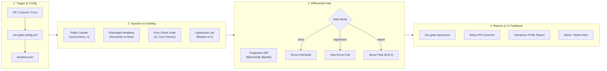

# seo-gate Architecture & Engineering Cheat Sheet (1-Page Reference)

> **Quick Summary:** `seo-gate` is an automated SEO regression guard for CI/CD that inspects web storefronts, detects client-side rendering gaps via Playwright, audits lab Core Web Vitals via Lighthouse, diffs against version-controlled baselines, and posts sticky PR reports.

---

---

### Core Data Contracts (`src/types.ts`)

| Concept | Schema Definition | Meaning |
|---|---|---|
| **`Finding`** | `{ checkId, url, severity, message, evidence, fixHint, docsLink }` | An atomic issue discovered on a specific page. |
| **`PageAudit`** | `{ url, statusCode, headers, html, renderedHtml?, redirectChain }` | Raw crawled and rendered page payload. |
| **`BaselineSnapshot`** | `{ schemaVersion: 1, createdAt, target, totalPages, findings, performance? }` | Saved gold-standard snapshot committed to Git. |
| **`DiffResult`** | `{ newFindings, resolvedFindings, unchangedFindings, regressions }` | Three-way partitioned comparison against baseline. |

---

### The 11 Core Checks at a Glance

| Category | Check ID | Default Severity | What It Inspects |
|---|---|---|---|
| **Indexability** | `noindex` | `error` | Blocks accidental `noindex` meta tags or `X-Robots-Tag` headers on indexable pages. |
| **Indexability** | `http-status` | `error` | Asserts HTTP 200; flags 4xx/5xx errors, redirect chains (>1 hop), and redirect loops. |
| **Indexability** | `canonical` | `error` | Asserts presence, absolute URL format, self-referencing consistency, and non-404 targets. |
| **Indexability** | `robots-txt` | `error` | Asserts robots.txt exists, flags accidental `Disallow: /`, and verifies critical paths. |
| **On-Page** | `title` | `warn` / `error` | Asserts existence, uniqueness across page set, and length bounds (20–65 characters). |
| **On-Page** | `meta-description` | `warn` | Asserts existence, uniqueness, and length bounds (70–160 characters). |
| **On-Page** | `h1` | `warn` / `error` | Asserts exactly one `<h1>` heading per page. |
| **Rendering** | `rendered-vs-raw` | `error` | Compares raw Cheerio HTML vs Playwright DOM to catch the **hydration gap** on SPA/LWC apps. |
| **Structured Data** | `structured-data` | `warn` / `error` | Validates JSON-LD syntax and asserts required schema properties (`Product`, `BreadcrumbList`, etc.). |
| **International** | `hreflang` | `error` | Asserts ISO language codes, self-references, and reciprocal return tags across languages. |
| **Sitemap** | `sitemap` | `warn` / `error` | Asserts sitemap URLs return 200, are canonical, and flags sudden URL drops (>10%). |

---

### Exit Codes & Gate Modes

| Mode | Behavior | Exit Code 0 | Exit Code 1 | Exit Code 2 |
|---|---|---|---|---|
| **`strict`** | Any error fails build | 0 errors | $\ge 1$ errors | Config error / unreachable target |
| **`regression`** | Fails only on *new* errors vs baseline | 0 new errors | $\ge 1$ new errors | Config error / unreachable target |
| **`report`** | Never fails; report-only | Always passes | Never returns 1 | Config error / unreachable target |

---

### Salesforce Analogy Quick Reference

- **Check Function** = Apex Test Method / SObject Validation Rule
- **Baseline Snapshot (`baseline.json`)** = Production Org Metadata Snapshot
- **Regression Mode** = `RunSpecifiedTests` (only test what changed)
- **Documented Ignore** = Documented Deployment Exception / Bypass Flag
- **Performance Budgets (LCP / JS kB)** = Apex CPU & Heap Size Governor Limits
- **Exit Code (`0` / `1`)** = Deployment Validation Status (`Success` / `Failure`)
